# Návod k instalaci H12

Tento návod je strojový překlad; opravy jsou vítány přes GitHub Issues.

Vítej v H12 (verze 1.0.0-beta.1). H12 je fanouškovský projekt založený na enginu fheroes2 a je vydán pod licencí GPL-2.0-or-later. Není nijak spojen se společnostmi Ubisoft ani New World Computing. "Heroes of Might and Magic" je ochranná známka příslušných vlastníků.

Toto vydání je verze BETA. Alfatest provedla hlavně umělá inteligence (automatické hry a automatické testy bez herního okna). Proto patříš mezi úplně první lidské testery, kteří H12 hrají. Děkujeme za každé hlášení chyby a návrh, které nám pošleš! Pokud narazíš na jakékoli problémy nebo se chceš podělit o zpětnou vazbu, podívej se prosím do části [Hlášení problémů](#hlášení-problémů) na konci tohoto návodu.

Tento návod vysvětluje, jak nainstalovat H12 na Windows a Android, jak přepínat mezi režimem Heroes 1 a Heroes 2 a jak zapnout nové hrady. Nejde o návod, jak hrát samotnou hru.

## Co potřebuješ

Součástí H12 nejsou žádné původní herní soubory a bez tvých vlastních souborů hru nelze spustit.

* **Pro oba režimy (Heroes II i Heroes I):** Potřebuješ vlastní kopii hry Heroes of Might and Magic II. Doporučujeme edici Gold z GOG. Datadisk Price of Loyalty je volitelný.
* **Pro režim Heroes 1 (volitelné):** Potřebuješ také vlastní kopii první hry Heroes of Might and Magic, která se rovněž prodává na GOG.

## Windows (PC)

Podle těchto kroků nainstaluješ a spustíš H12 na PC s Windows:

1. Stáhni `H12-1.0.0-beta.1-windows-x64.zip` ze stránky vydání.
2. Rozbal celý archiv ZIP do zapisovatelné složky v počítači, například `C:\Games\H12`. Ujisti se, že `H12.exe`, všech šest souborů DLL (`SDL2.dll`, `SDL2_mixer.dll`, `libz.dll`, `libc++.dll`, `libunwind.dll`, `libwinpthread-1.dll`), složka `files` a složka `data` zůstanou společně na stejném místě.
3. **Přidej soubory Heroes II (povinné):** Otevři instalační složku své původní hry Heroes II. Zkopíruj obsah složek `DATA`, `MAPS`, `MUSIC` a `ANIM` do složek se stejnými názvy přímo vedle `H12.exe` (v případě potřeby tyto složky vytvoř).
   * `DATA/HEROES2.AGG` je povinný pro spuštění hry.
   * `DATA/HEROES2X.AGG` je volitelný a zpřístupňuje obsah Price of Loyalty.
   * Přibalené podsložky s PNG ponech uvnitř `data/`. Windows považuje `DATA` a `data` za tutéž složku, takže zkopírované soubory z `DATA` přijdou přímo do této existující složky vedle podsložek s PNG.
4. **Přidej soubory Heroes I (volitelné, pro režim I):** Otevři složku své původní hry Heroes of Might and Magic a zkopíruj následující soubory do složky H12:
   * Zkopíruj `DATA\HEROES.AGG` do `DATA\HEROES.AGG` (povinné pro režim I).
   * Zkopíruj `HEROES.EXE` do `DATA\HEROES.EXE` (povinné pro režim I; tento soubor se pouze čte jako data a nikdy se nespouští).
   * Zkopíruj `homm1.gog` do `DATA\homm1.gog` (volitelné; přidává hudbu a videa z Heroes I).
   * Zkopíruj původní soubory map `MAPS\*.MAP` a `MAPS\*.CMP` do složky `MAPS\` vedle `H12.exe` (volitelné; přidává scénáře z Heroes I, které H12 automaticky převádí).
5. Spusť hru souborem `H12.exe`. Windows může zobrazit varování SmartScreen, protože program není podepsaný.

Takto vypadá tvá složka těsně po rozbalení archivu ZIP s H12 a takto vypadá po přidání souborů z tvých původních her:

```text
PŘED (rozbaleno z H12-1.0.0-beta.1-windows-x64.zip):
C:\Games\H12\
├── H12.exe
├── SDL2.dll
├── SDL2_mixer.dll
├── libz.dll
├── libc++.dll
├── libunwind.dll
├── libwinpthread-1.dll
├── files\
└── data\
    └── (přibalené podsložky s PNG)

PO (po zkopírování souborů Heroes II a Heroes I):
C:\Games\H12\
├── H12.exe
├── SDL2.dll
├── SDL2_mixer.dll
├── libz.dll
├── libc++.dll
├── libunwind.dll
├── libwinpthread-1.dll
├── files\
├── DATA\ (stejná složka jako data\)
│   ├── (přibalené podsložky s PNG)
│   ├── HEROES2.AGG
│   ├── HEROES2X.AGG         (volitelné, Price of Loyalty)
│   ├── HEROES.AGG           (povinné pro režim I)
│   ├── HEROES.EXE           (povinné pro režim I, čte se pouze jako data)
│   └── homm1.gog            (volitelné, hudba a videa z Heroes I)
├── MAPS\
│   ├── (mapy Heroes II)
│   └── (soubory *.MAP a *.CMP z Heroes I)
├── MUSIC\
│   └── (hudební soubory Heroes II)
└── ANIM\
    └── (animační soubory Heroes II)
```

Tvá nastavení, uložené hry a soubor s logem jsou uloženy v `%APPDATA%\fheroes2`:
* Uložené hry: `%APPDATA%\fheroes2\files\save`
* Soubor s logem: `%APPDATA%\fheroes2\fheroes2.log`

Jde o přesně tutéž složku, kterou používá standardní engine fheroes2. Pokud na svém PC používáš i fheroes2, oba programy tuto složku sdílejí.

## Android

Podle těchto kroků nainstaluješ H12 a nahraješ herní data na Androidu:

1. Stáhni `H12-1.0.0-beta.1.apk` ze stránky vydání a nainstaluj jej do telefonu. Až se telefon zeptá, povol instalaci aplikací z neznámých zdrojů. Aplikace nepotřebuje oprávnění k přístupu na internet.
2. Na počítači vytvoř soubor ZIP ze složky své hry Heroes II. Musí obsahovat `DATA/HEROES2.AGG`. Pokud je uvnitř ZIPu i `DATA/HEROES2X.AGG`, Price of Loyalty se zahrne automaticky.
3. Pokud chceš hrát režim I, vytvoř druhý soubor ZIP ze složky své hry Heroes of Might and Magic. Musí obsahovat `DATA/HEROES.AGG` a `HEROES.EXE`. Zahrnutí složky `MAPS` (se soubory `.MAP` a `.CMP`) a souboru `homm1.gog` je volitelné. Každý soubor ZIP má přibližně 400 MB, proto se ujisti, že máš v telefonu dostatek volného místa.
4. Zkopíruj soubor ZIP (nebo oba soubory ZIP) do telefonu, například do složky `Downloads`.
5. Otevři H12 na telefonu. Úvodní obrazovka hlásí `"The game needs the data of your own copy."` ("Hra potřebuje data tvé vlastní hry.") a zobrazuje seznam stavu `"Loaded:"` ("Nahrané:") (`Heroes 2`, `Price of Loyalty`, `Heroes 1`, `Heroes 1 maps` ("Mapy Heroes 1"), `homm1.gog`). Tlačítko `"START GAME"` ("SPUSTIT HRU") je neaktivní, dokud není nahráno `Heroes 2`. Úvodní obrazovka také zobrazuje odkazy pro zpětnou vazbu.

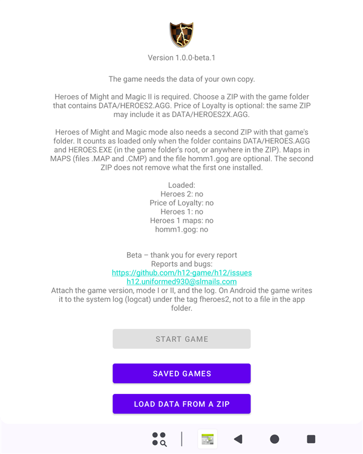

6. Klepni na `"LOAD DATA FROM A ZIP"` ("NAHRÁT DATA ZE ZIPU") a ve výběru souborů zvol svůj soubor ZIP s Heroes II.

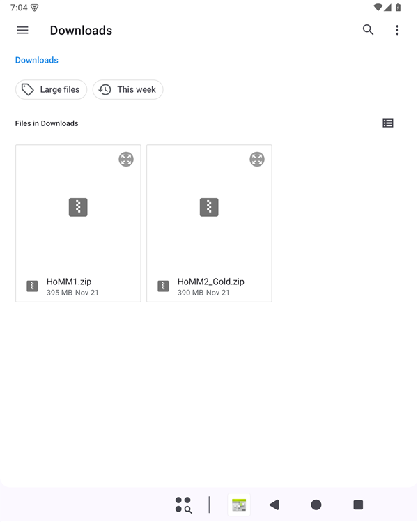

7. Počkej, než hra archiv rozbalí. Rozbalování trvá minutu nebo dvě; nech prosím obrazovku zapnutou. Po dokončení se na obrazovce zobrazí `"Heroes 2: yes"` (a `"Price of Loyalty: yes"`, pokud byl zahrnut).


8. Pro režim I klepni znovu na `"LOAD DATA FROM A ZIP"` a zvol svůj soubor ZIP s Heroes I. Nahrání druhého ZIPu neodstraní to, co nainstaloval ten první. Po dokončení je na všech pěti řádcích uvedeno `"yes"` ("ano").

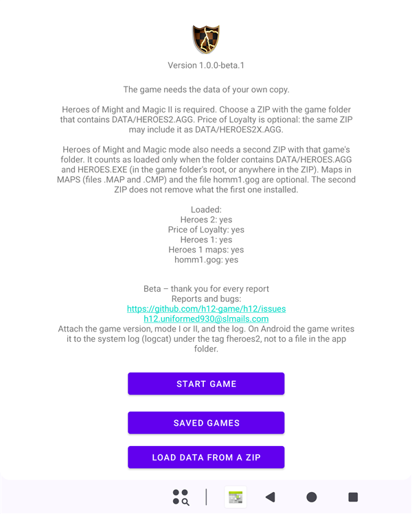

9. Klepnutím na `"START GAME"` spusť H12. Z této obrazovky můžeš také spravovat své uložené hry klepnutím na `"SAVED GAMES"` ("ULOŽENÉ HRY").

## První spuštění

Při prvním spuštění tě hra vyzve k výběru jazyka pod `"Select Game Language:"` ("Vybrat jazyk hry:"). Předvybrána je angličtina.

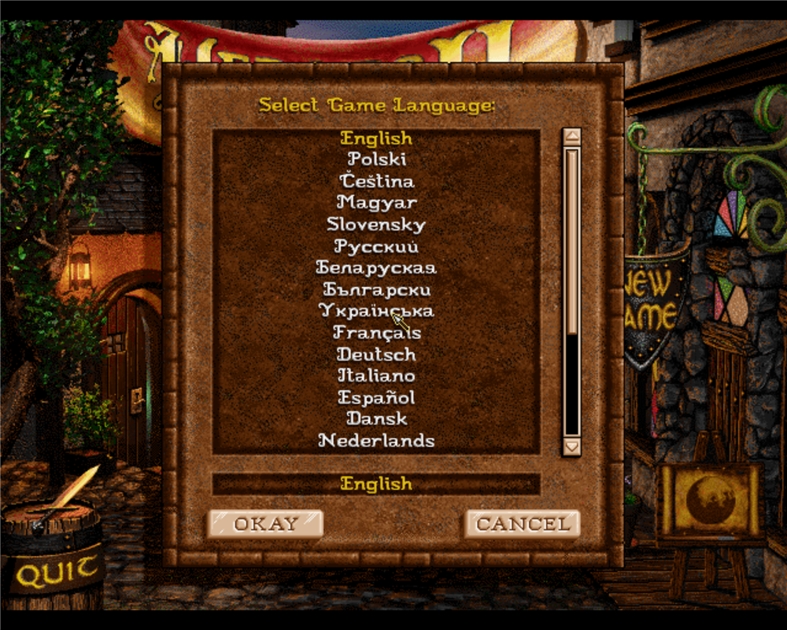

Po potvrzení jazyka se zobrazí krátká uvítací zpráva. Vysvětluje, že na dotykových obrazovkách dlouhý dotyk následovaný druhým dotykem simuluje kliknutí pravým tlačítkem myši.

## Přepínání mezi Heroes II a Heroes I

Mezi Heroes II (režim II) a Heroes I (režim I) můžeš přepínat v nastavení hry, které otevřeš z hlavní nabídky. Hra si zvolený režim zapamatuje pro příští spuštění.

1. V hlavní nabídce Heroes II otevři nastavení hry klepnutím (nebo kliknutím) na dveře domu vlevo. Můžeš také klepnout na `"SETTINGS"` ("Nastavení") v nabídce `"NEW GAME"` ("Nová hra") v Heroes II, nebo na PC stisknout klávesu `T` v hlavní nabídce.

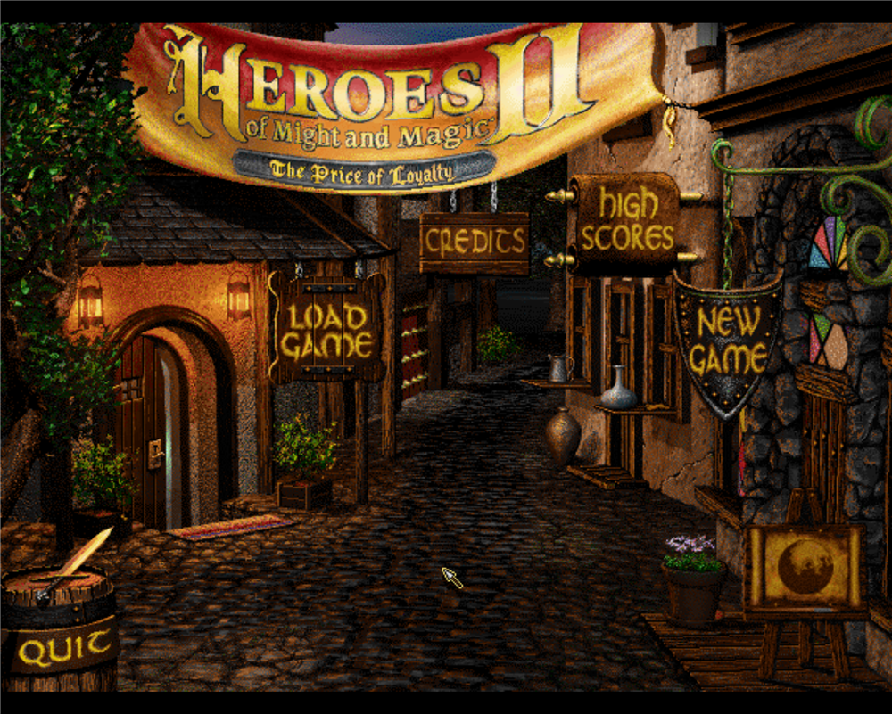

2. V okně nastavení vyhledej `"Game Version"` ("Verze hry"). Zobrazuje `"Heroes 2"` nebo `"Heroes 1"`. Klepnutím (nebo kliknutím) na tuto položku přepneš mezi oběma režimy.

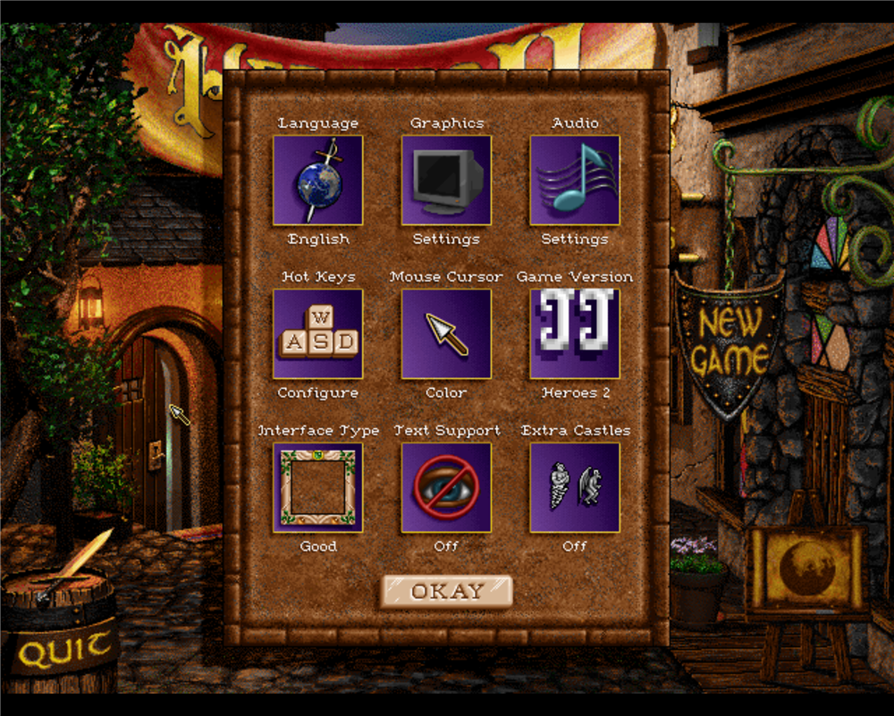

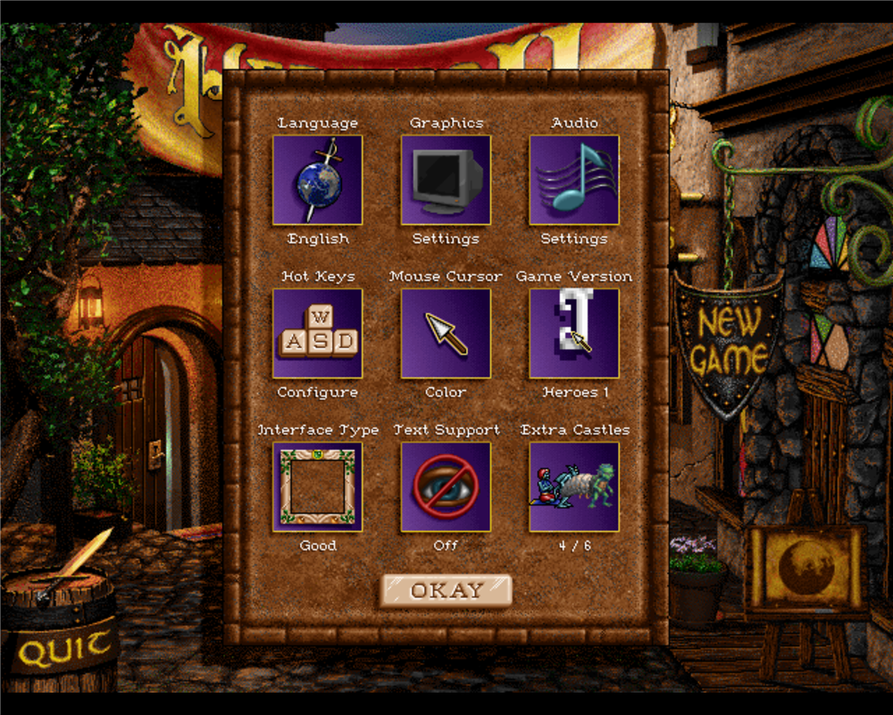

3. Pokud se pokusíš přepnout na `"Heroes 1"`, aniž bys měl nainstalované povinné soubory Heroes I, hra zobrazí zprávu `"Heroes 1 data required"` ("Jsou potřeba data Heroes 1") a zůstane v režimu Heroes II.

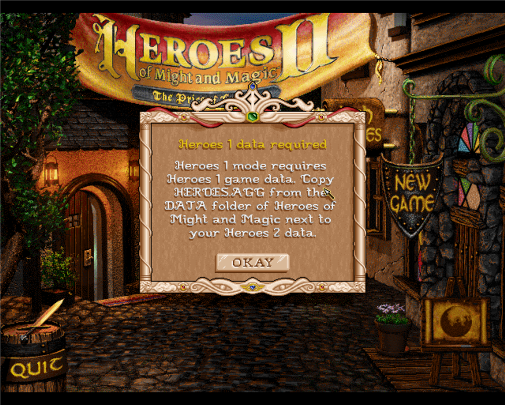

4. Když přepneš do režimu I, hlavní nabídka se změní tak, aby vypadala jako v původní hře Heroes of Might and Magic.

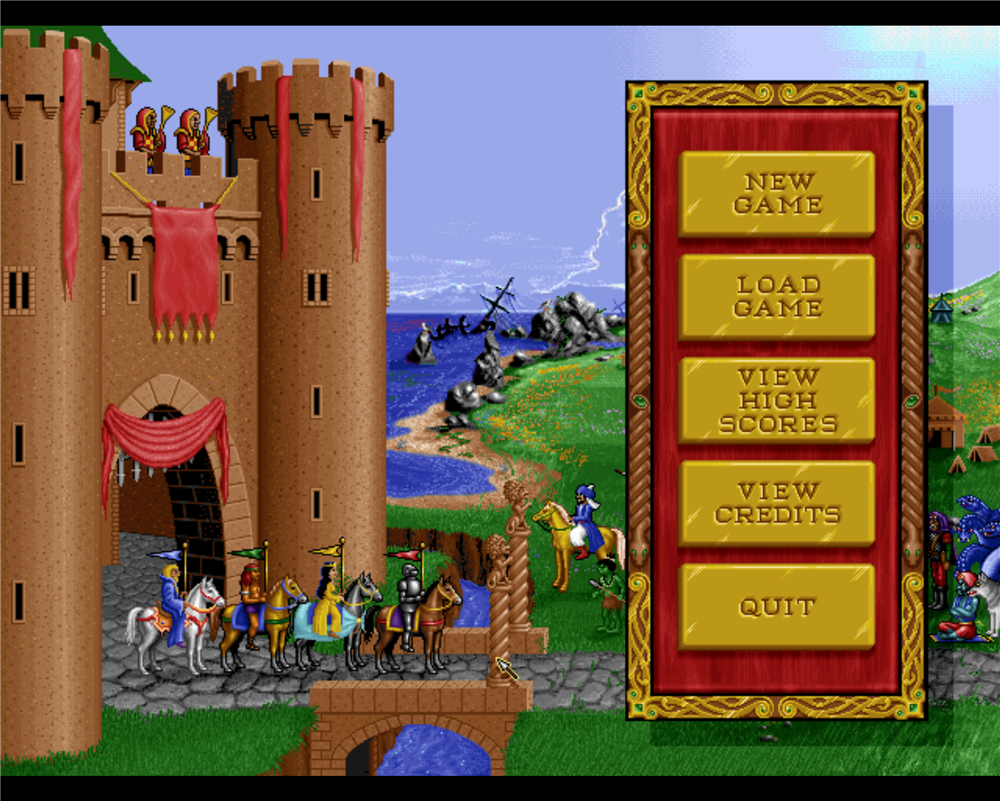

5. Chceš-li otevřít nastavení, když jsi v hlavní nabídce režimu I, klepni (nebo klikni) na levou věž hradu, případně na PC stiskni klávesu `T`.

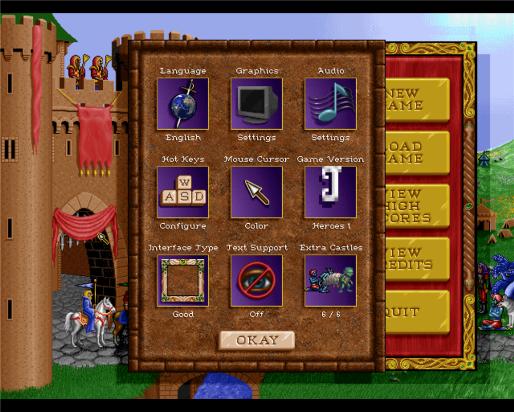

## Nové hrady

H12 obsahuje nové hrady, které jsou ve výchozím nastavení přepnuté na `Off` ("Vyp"). Zapneš je v nastavení hry:

1. Otevři nastavení a klepni na `"Extra Castles"` ("Hrady navíc").
2. V režimu II okno nabízí čtyři nové hrady: `Oasis` ("Oáza"), `Inferno` ("Inferno"), `Hive` ("Úl") a `Atoll` ("Atol"). Klepnutím na název hradu jej přepneš na `On` ("Zap") nebo `Off`.

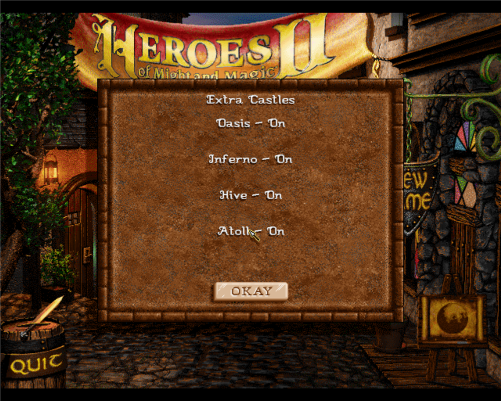

3. V režimu I okno `"Extra Castles"` navíc nabízí `Wizard` ("Kouzelník") a `Necromancer` ("Nekromant"), což ti dává celkem 6 hradů navíc. Klepnutím na libovolný název jej přepneš na `On` nebo `Off`.

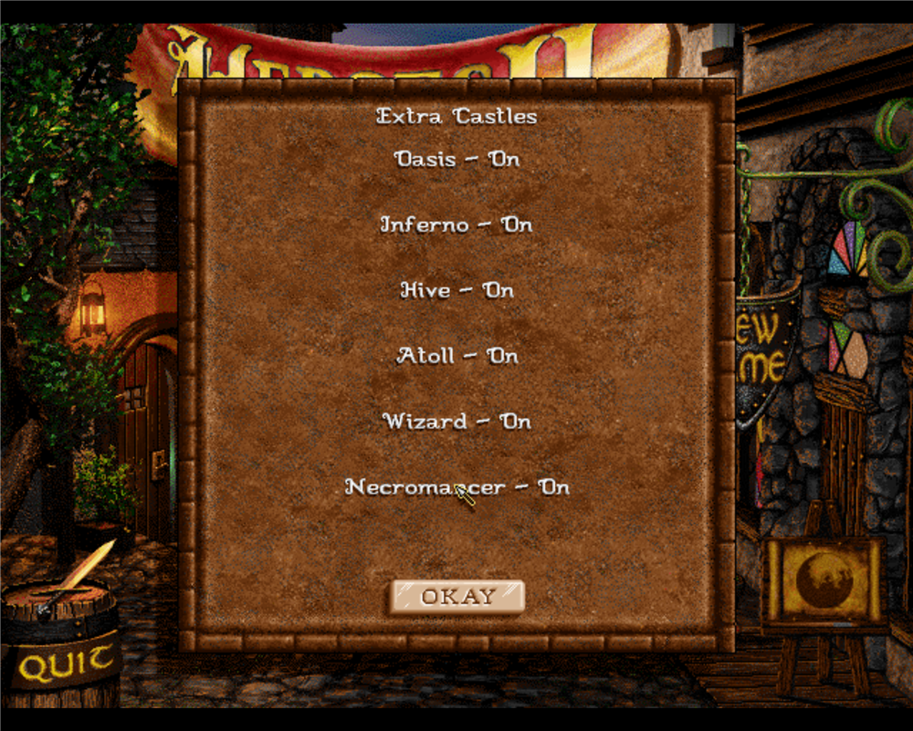

Když je zapneš, můžeš nové hrady vybrat při spouštění standardní hry:

* **V režimu II:** Přejdi do `"NEW GAME"` -> `"STANDARD GAME"` ("Standardní hra") a pomocí `"SELECT"` vyber scénář. Pod `"Class:"` ("Rasa:") klepni na obrázek své rasy, čímž budeš postupně přepínat mezi všemi dostupnými rasami včetně nových hradů. Všimni si, že některé mapy mají pevně dané rasy (zobrazené jako šedý obrázek). Chceš-li nové hrady vyzkoušet, vyber mapu, u které lze rasu změnit, například `"Pandemonium"` nebo `"Broken Alliance"`.

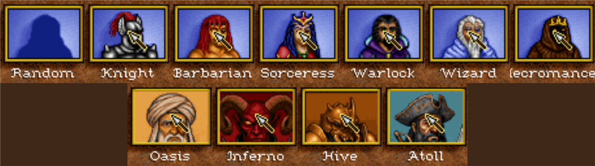

* **V režimu I:** Přejdi do `"NEW GAME"` -> `"STANDARD GAME"`. Pod `"Choose Color:"` ("Zvol barvu:") klepni na ikonu jezdce, čímž budeš postupně přepínat mezi všemi povolenými hrady (celkem až deset: Knight ("Rytíř"), Barbarian, Sorceress, Warlock, Oasis, Inferno, Hive, Atoll, Wizard a Necromancer).

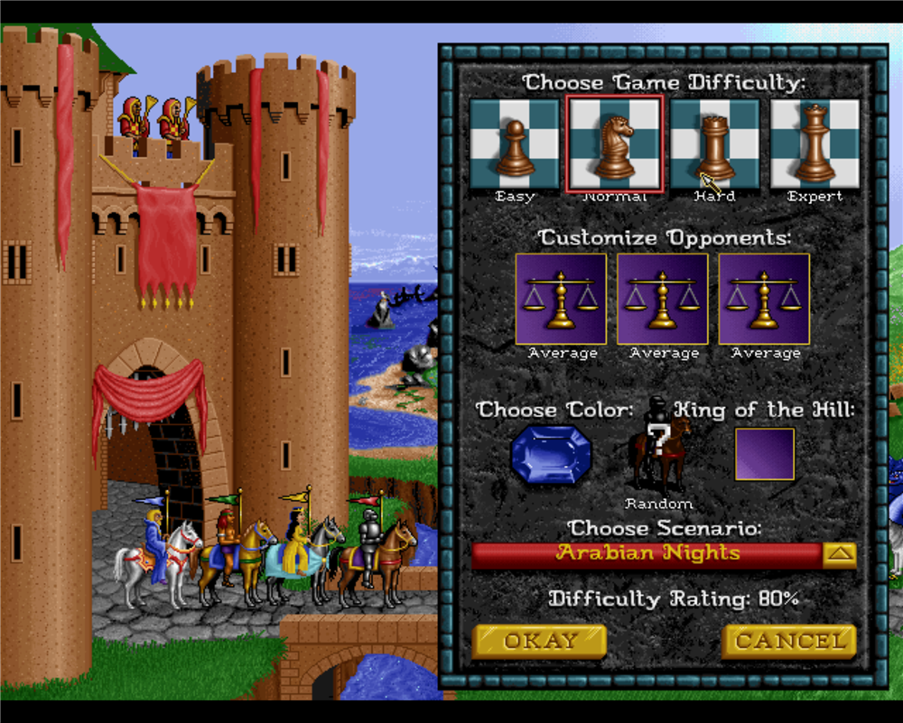

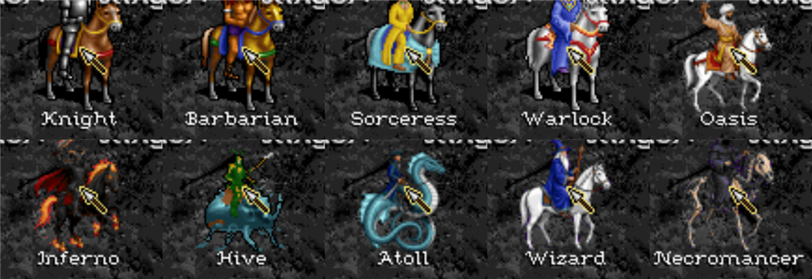

Každý hrad má vlastní obrazovku města a vlastní vzhled.

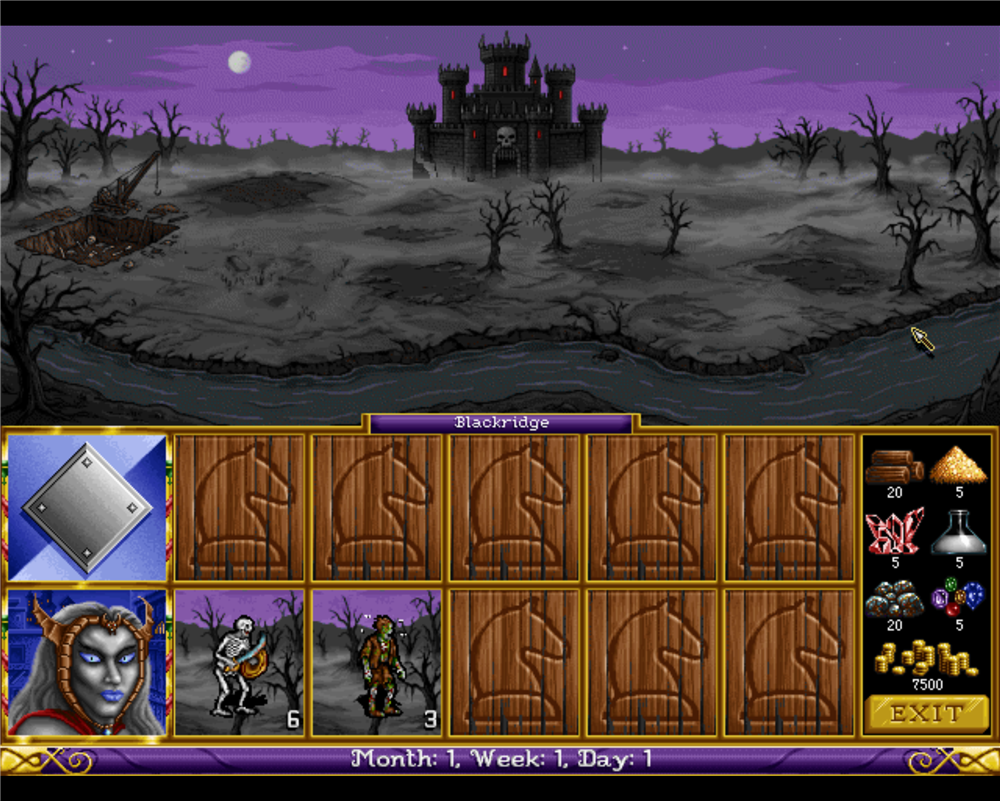

## Hlášení problémů

Ještě jednou děkujeme, že testuješ tuto betu a pomáháš nám H12 vylepšovat! Chyby a návrhy můžeš hlásit dvěma způsoby:

* **GitHub Issues:** https://github.com/h12-game/h12/issues
* **E-mail:** h12.uniformed930@slmails.com

Při hlášení problému prosím uveď následující podrobnosti:
* Verze hry (`1.0.0-beta.1`)
* Platforma (`PC` nebo `Android`)
* Režim hry (I nebo II)
* Zda máš nainstalovaný datadisk Price of Loyalty
* Jasné kroky k zopakování problému
* Herní log a případně i soubor uložené hry

**Kde najdeš log:**
* **PC:** Soubor s logem je uložen v `%APPDATA%\fheroes2\fheroes2.log` (uložené hry jsou v `%APPDATA%\fheroes2\files\save`).
* **Android:** Hra zapisuje svůj log do systémového logu Androidu (`logcat`) pod značkou `fheroes2`. Nezapisuje soubor s logem do složky aplikace.

**Poznámka k soukromí:** GitHub Issues jsou veřejné. Pokud pošleš e-mail, zprávy jsou přeposílány přes aliasovou službu do schránky, kde je třídí automatizovaný asistent (AI). E-maily jsou uchovávány nejvýše 12 měsíců a zprávy zadržené jako spam se mažou po 30 dnech.

## Známé drobné problémy v této betě

* V režimu II může popisek `"Extra Castles"` v hlavním okně nastavení ukazovat `"Oasis + Inferno"`, i když jsou `Hive` a `Atoll` také přepnuté na `On`. Skutečný stav každého hradu uvidíš po otevření okna `"Extra Castles"`.
* Zpráva `"Heroes 1 data required"` zmiňuje pouze `HEROES.AGG`, ale režim I ve skutečnosti vyžaduje jak `HEROES.AGG`, tak `HEROES.EXE`.
