# H12-Installationsanleitung

Diese Anleitung ist eine maschinelle Übersetzung; Korrekturen sind über GitHub Issues willkommen.

Willkommen bei H12 (Version 1.0.0-beta.1). H12 ist ein Fan-Projekt auf Basis der fheroes2-Engine und wird unter der Lizenz GPL-2.0-or-later veröffentlicht. Es steht in keiner Verbindung zu Ubisoft oder New World Computing. „Heroes of Might and Magic“ ist eine Marke der jeweiligen Eigentümer.

Diese Veröffentlichung ist eine BETA-Version. Der Alphatest wurde hauptsächlich von künstlicher Intelligenz durch automatisierte Spiele und automatisierte Tests ohne Spielfenster durchgeführt. Daher gehören Sie zu den allerersten menschlichen Testern, die H12 spielen. Vielen Dank für jeden Fehlerbericht und jeden Vorschlag, den Sie uns senden! Wenn Sie Probleme finden oder Feedback teilen möchten, lesen Sie bitte den Abschnitt [Probleme melden](#probleme-melden) am Ende dieser Anleitung.

Diese Anleitung erklärt, wie Sie H12 unter Windows und Android installieren, wie Sie zwischen dem Heroes-1- und dem Heroes-2-Modus wechseln und wie Sie die neuen Schlösser aktivieren. Es ist keine Anleitung zum Spielen des Spiels selbst.

## Was Sie benötigen

In H12 sind keine Originalspieldateien enthalten, und das Spiel kann ohne Ihre eigenen Dateien nicht starten.

* **Für beide Modi (Heroes II und Heroes I):** Sie benötigen Ihre eigene Kopie von Heroes of Might and Magic II. Wir empfehlen die Gold-Edition von GOG. Die Erweiterung Price of Loyalty ist optional.
* **Für den Heroes-1-Modus (optional):** Sie benötigen außerdem Ihre eigene Kopie des ersten Spiels Heroes of Might and Magic, das ebenfalls auf GOG verkauft wird.

## Windows (PC)

Befolgen Sie diese Schritte, um H12 auf einem Windows-PC zu installieren und auszuführen:

1. Laden Sie `H12-1.0.0-beta.1-windows-x64.zip` von der Release-Seite herunter.
2. Entpacken Sie das komplette ZIP-Archiv in einen beschreibbaren Ordner auf Ihrem Computer, zum Beispiel `C:\Games\H12`. Stellen Sie sicher, dass `H12.exe`, alle sechs DLL-Dateien (`SDL2.dll`, `SDL2_mixer.dll`, `libz.dll`, `libc++.dll`, `libunwind.dll`, `libwinpthread-1.dll`), der Ordner `files` und der Ordner `data` zusammen am selben Ort bleiben.
3. **Heroes-II-Dateien hinzufügen (erforderlich):** Öffnen Sie Ihren ursprünglichen Installationsordner von Heroes II. Kopieren Sie den Inhalt der Ordner `DATA`, `MAPS`, `MUSIC` und `ANIM` in gleichnamige Ordner direkt neben `H12.exe` (erstellen Sie diese Ordner bei Bedarf).
   * `DATA/HEROES2.AGG` ist erforderlich, um das Spiel zu starten.
   * `DATA/HEROES2X.AGG` ist optional und aktiviert Inhalte von Price of Loyalty.
   * Behalten Sie die mitgelieferten PNG-Unterordner innerhalb von `data/`. Windows behandelt `DATA` und `data` als denselben Ordner, sodass Ihre kopierten `DATA`-Dateien direkt neben den PNG-Unterordnern in diesem vorhandenen Ordner landen.
4. **Heroes-I-Dateien hinzufügen (optional, für Modus I):** Öffnen Sie Ihren ursprünglichen Ordner von Heroes of Might and Magic und kopieren Sie die folgenden Dateien in Ihren H12-Ordner:
   * Kopieren Sie `DATA\HEROES.AGG` nach `DATA\HEROES.AGG` (erforderlich für Modus I).
   * Kopieren Sie `HEROES.EXE` nach `DATA\HEROES.EXE` (erforderlich für Modus I; diese Datei wird nur als Daten gelesen und niemals ausgeführt).
   * Kopieren Sie `homm1.gog` nach `DATA\homm1.gog` (optional; fügt Musik und Videos von Heroes I hinzu).
   * Kopieren Sie die ursprünglichen Kartendateien `MAPS\*.MAP` und `MAPS\*.CMP` in den Ordner `MAPS\` neben `H12.exe` (optional; fügt Szenarien von Heroes I hinzu, die H12 automatisch konvertiert).
5. Starten Sie das Spiel, indem Sie `H12.exe` ausführen. Windows zeigt möglicherweise eine SmartScreen-Warnung an, da das Programm nicht signiert ist.

So sieht Ihr Ordner direkt nach dem Entpacken des H12-ZIP-Archivs aus und so, nachdem Sie Ihre Originalspieldateien hinzugefügt haben:

```text
VORHER (entpackt aus H12-1.0.0-beta.1-windows-x64.zip):
C:\Games\H12\
├── H12.exe
├── SDL2.dll
├── SDL2_mixer.dll
├── libz.dll
├── libc++.dll
├── libunwind.dll
├── libwinpthread-1.dll
├── files\
└── data\
    └── (mitgelieferte PNG-Unterordner)

NACHHER (mit hineinkopierten Dateien von Heroes II und Heroes I):
C:\Games\H12\
├── H12.exe
├── SDL2.dll
├── SDL2_mixer.dll
├── libz.dll
├── libc++.dll
├── libunwind.dll
├── libwinpthread-1.dll
├── files\
├── DATA\ (derselbe Ordner wie data\)
│   ├── (mitgelieferte PNG-Unterordner)
│   ├── HEROES2.AGG
│   ├── HEROES2X.AGG         (optional, Price of Loyalty)
│   ├── HEROES.AGG           (erforderlich für Modus I)
│   ├── HEROES.EXE           (erforderlich für Modus I, wird nur als Daten gelesen)
│   └── homm1.gog            (optional, Musik und Videos von Heroes I)
├── MAPS\
│   ├── (Karten von Heroes II)
│   └── (*.MAP- und *.CMP-Dateien aus Heroes I)
├── MUSIC\
│   └── (Musikdateien von Heroes II)
└── ANIM\
    └── (Animationsdateien von Heroes II)
```

Ihre Einstellungen, Spielstände und die Protokolldatei werden in `%APPDATA%\fheroes2` gespeichert:
* Spielstände: `%APPDATA%\fheroes2\files\save`
* Protokolldatei: `%APPDATA%\fheroes2\fheroes2.log`

Dies ist genau derselbe Ordner, den auch die reguläre fheroes2-Engine verwendet. Wenn Sie auf Ihrem PC auch fheroes2 nutzen, teilen sich beide Programme diesen Ordner.

## Android

Befolgen Sie diese Schritte, um H12 zu installieren und Ihre Spieldaten unter Android zu laden:

1. Laden Sie `H12-1.0.0-beta.1.apk` von der Release-Seite herunter und installieren Sie sie auf Ihrem Telefon. Erlauben Sie die Installation von Apps aus unbekannten Quellen, wenn Ihr Telefon danach fragt. Die App benötigt keine Internetberechtigung.
2. Erstellen Sie auf einem Computer eine ZIP-Datei aus Ihrem Spielordner von Heroes II. Sie muss `DATA/HEROES2.AGG` enthalten. Wenn sich `DATA/HEROES2X.AGG` in der ZIP-Datei befindet, wird Price of Loyalty automatisch mit eingebunden.
3. Wenn Sie Modus I spielen möchten, erstellen Sie eine zweite ZIP-Datei aus Ihrem Ordner von Heroes of Might and Magic. Sie muss `DATA/HEROES.AGG` und `HEROES.EXE` enthalten. Das Einschließen des Ordners `MAPS` (mit `.MAP`- und `.CMP`-Dateien) sowie `homm1.gog` ist optional. Jede ZIP-Datei ist etwa 400 MB groß, stellen Sie also sicher, dass Ihr Telefon über genügend freien Speicherplatz verfügt.
4. Kopieren Sie die ZIP-Datei (oder beide ZIP-Dateien) auf Ihr Telefon, zum Beispiel in den Ordner `Downloads`.
5. Öffnen Sie H12 auf Ihrem Telefon. Auf dem Startbildschirm steht `"The game needs the data of your own copy."` und es wird eine Statusliste `"Loaded:"` angezeigt (`Heroes 2`, `Price of Loyalty`, `Heroes 1`, `Heroes 1 maps`, `homm1.gog`). Die Schaltfläche `"START GAME"` („SPIEL STARTEN“) ist deaktiviert, bis `Heroes 2` geladen wurde. Der Startbildschirm zeigt außerdem die Links für Feedback an.

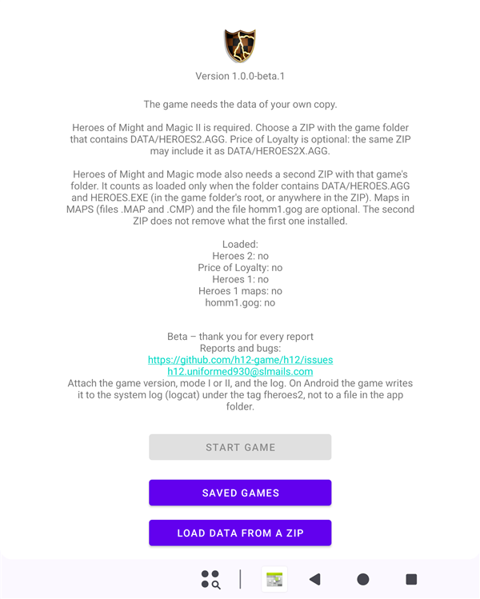

6. Tippen Sie auf `"LOAD DATA FROM A ZIP"` und wählen Sie Ihre Heroes-II-ZIP-Datei in der Dateiauswahl aus.

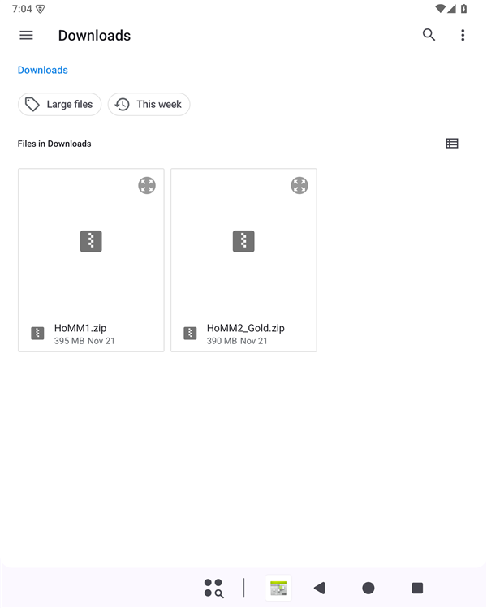

7. Warten Sie, während das Spiel das Archiv entpackt. Das Entpacken dauert ein bis zwei Minuten; bitte lassen Sie den Bildschirm geöffnet. Wenn der Vorgang abgeschlossen ist, zeigt der Bildschirm `"Heroes 2: yes"` an (sowie `"Price of Loyalty: yes"`, falls enthalten).


8. Für Modus I tippen Sie erneut auf `"LOAD DATA FROM A ZIP"` und wählen Ihre Heroes-I-ZIP-Datei aus. Das Laden der zweiten ZIP-Datei entfernt nicht das, was durch die erste installiert wurde. Sobald der Vorgang abgeschlossen ist, steht in allen fünf Zeilen `"yes"`.

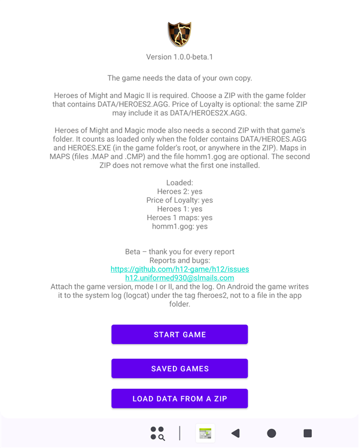

9. Tippen Sie auf `"START GAME"`, um H12 zu starten. Sie können von diesem Bildschirm aus auch Ihre Spielstände verwalten, indem Sie auf `"SAVED GAMES"` („SPIELSTAND-VERWALTUNG“) tippen.

## Erster Start

Wenn Sie das Spiel zum ersten Mal starten, werden Sie aufgefordert, unter `"Select Game Language:"` („Spielsprache wählen:“) eine Sprache auszuwählen. Englisch ist vorausgewählt.

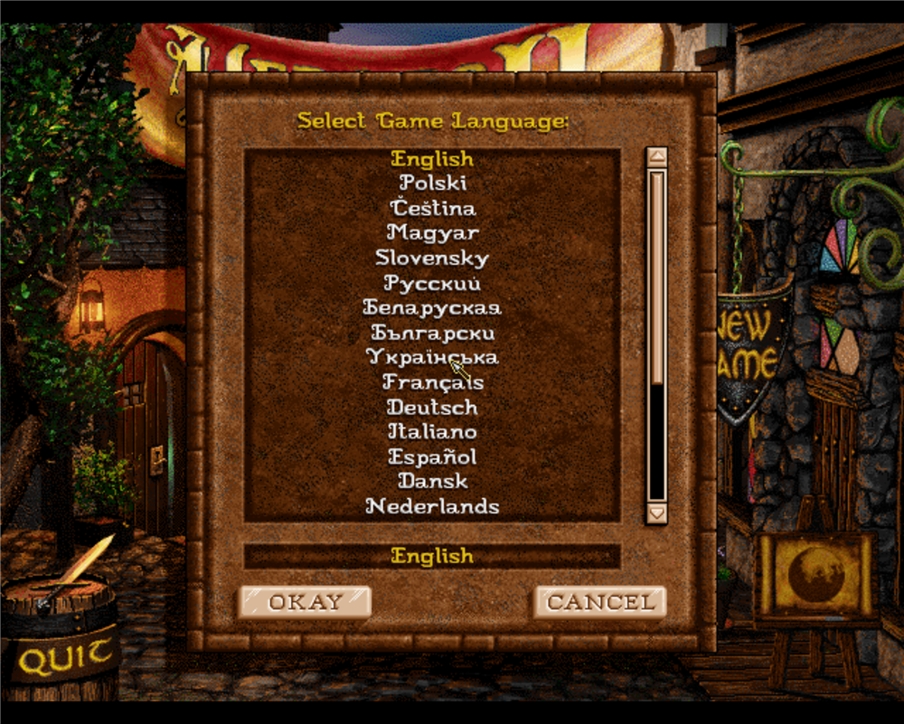

Nachdem Sie die Sprache bestätigt haben, erscheint eine kurze Willkommensnachricht. Sie erklärt, dass auf Touchscreens ein langes Berühren gefolgt von einer zweiten Berührung einen Rechtsklick simuliert.

## Wechsel zwischen Heroes II und Heroes I

Sie können in den Spieleinstellungen, die Sie über das Hauptmenü öffnen, zwischen Heroes II (Modus II) und Heroes I (Modus I) wechseln. Das Spiel merkt sich den gewählten Modus für den nächsten Start.

1. Öffnen Sie im Hauptmenü von Heroes II die Spieleinstellungen, indem Sie auf die Tür des Hauses auf der linken Seite tippen (oder klicken). Sie können auch im Menü `"NEW GAME"` („Neues Spiel“) von Heroes II auf `"SETTINGS"` („Einstellungen“) tippen oder auf einem PC im Hauptmenü die Taste `T` drücken.

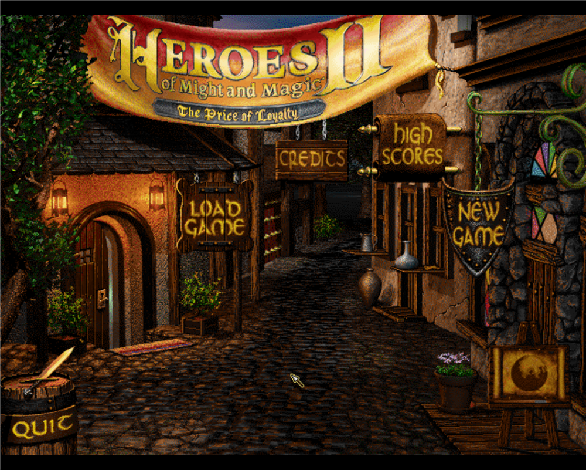

2. Suchen Sie im Einstellungsfenster nach `"Game Version"`. Dort wird `"Heroes 2"` oder `"Heroes 1"` angezeigt. Tippen (oder klicken) Sie darauf, um zwischen den beiden Modi zu wechseln.


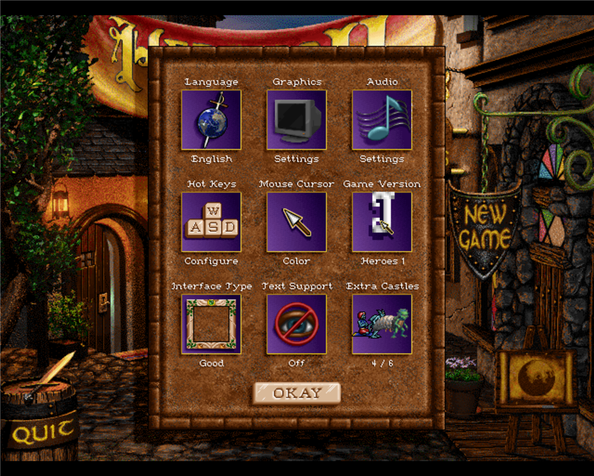

3. Wenn Sie versuchen, auf `"Heroes 1"` umzuschalten, ohne dass die erforderlichen Heroes-I-Dateien installiert sind, zeigt das Spiel die Meldung `"Heroes 1 data required"` an und bleibt im Heroes-II-Modus.

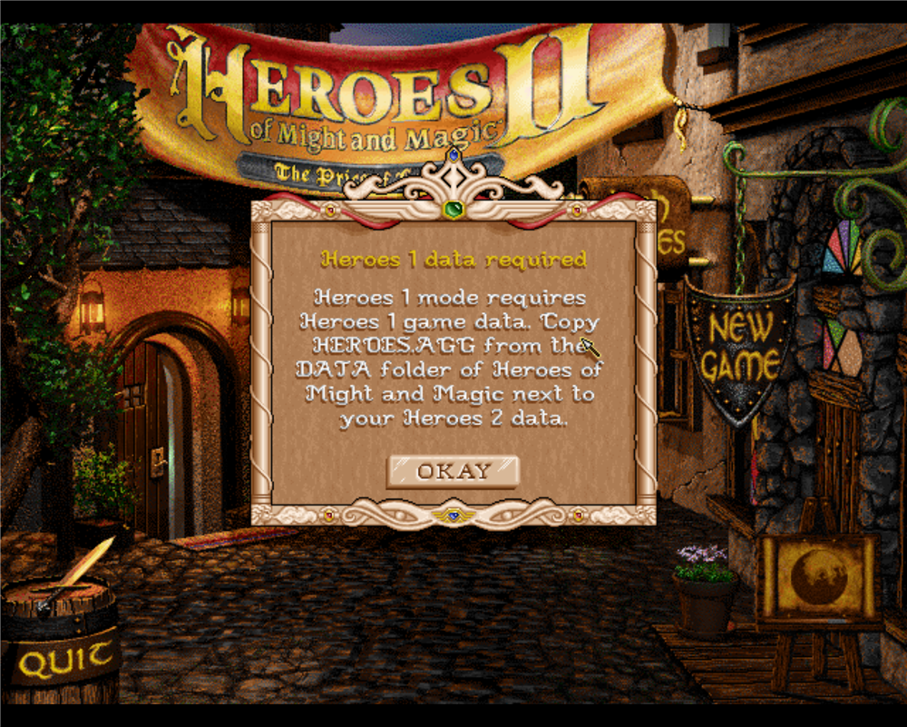

4. Wenn Sie in Modus I wechseln, ändert sich das Hauptmenü so, dass es wie das ursprüngliche Heroes of Might and Magic aussieht.

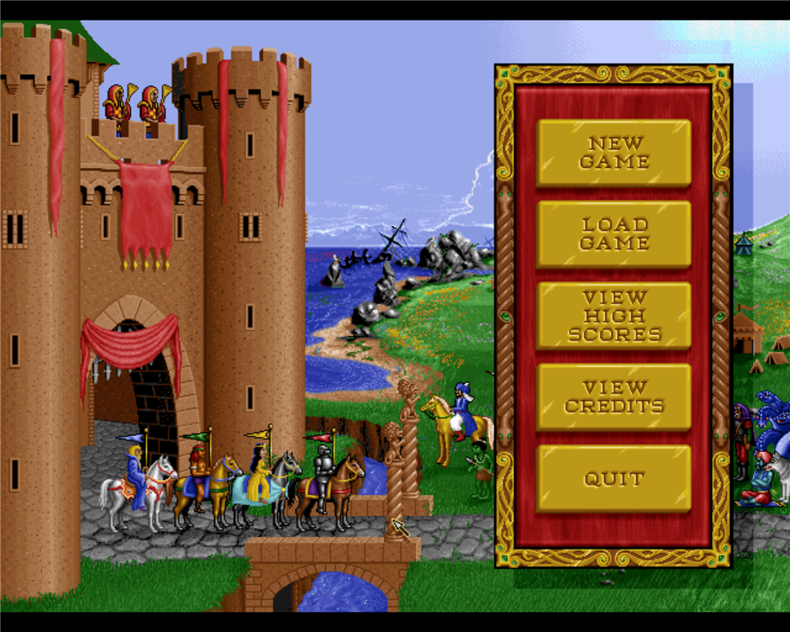

5. Um die Einstellungen zu öffnen, während Sie sich im Hauptmenü von Modus I befinden, tippen (oder klicken) Sie auf den linken Turm des Schlosses oder drücken Sie auf einem PC die Taste `T`.

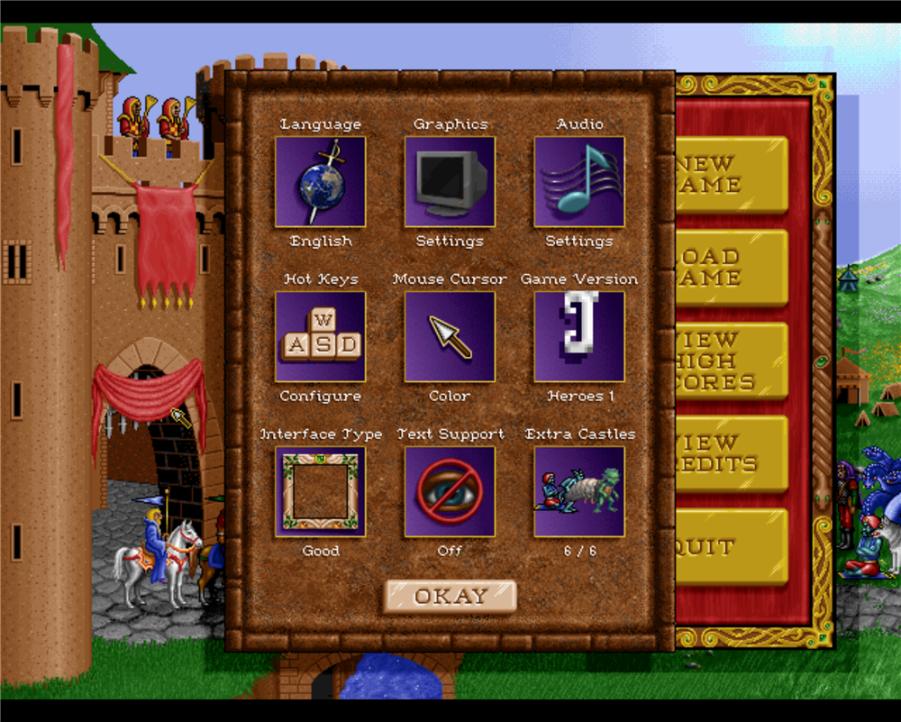

## Neue Schlösser

H12 enthält neue Schlösser, die standardmäßig auf `Off` („Aus“) gestellt sind. Sie können sie in den Spieleinstellungen aktivieren:

1. Öffnen Sie die Einstellungen und tippen Sie auf `"Extra Castles"`.
2. In Modus II bietet das Fenster vier neue Schlösser an: `Oasis` („Oase“), `Inferno`, `Hive` und `Atoll`. Tippen Sie auf den Namen eines Schlosses, um es auf `On` („An“) oder `Off` zu schalten.


3. In Modus I bietet das Fenster `"Extra Castles"` zusätzlich `Wizard` („Zauberer“) und `Necromancer` („Totenbeschwörer“) an, sodass Ihnen insgesamt 6 zusätzliche Schlösser zur Verfügung stehen. Tippen Sie auf einen beliebigen Namen, um ihn auf `On` oder `Off` zu schalten.

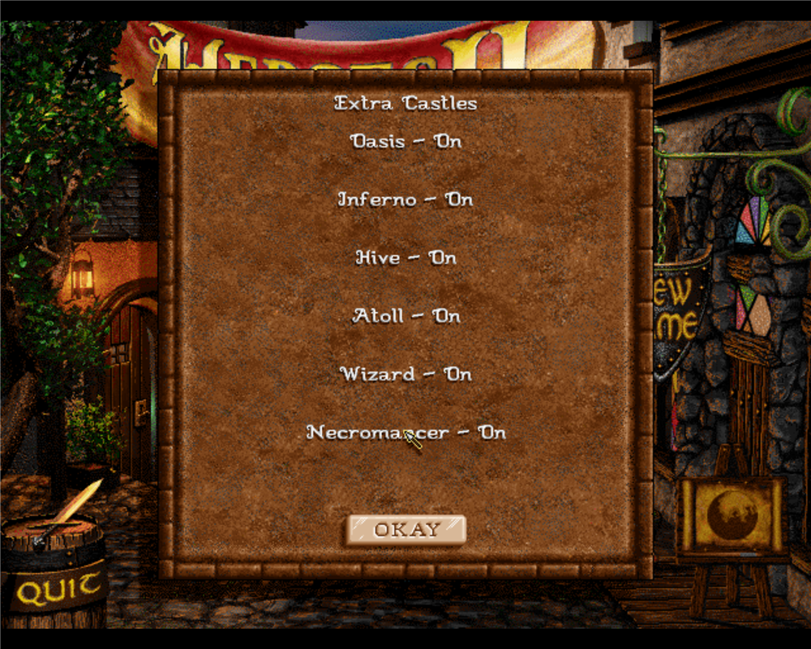

Sobald sie aktiviert sind, können Sie die neuen Schlösser beim Starten eines Standardspiels auswählen:

* **In Modus II:** Gehen Sie zu `"NEW GAME"` -> `"STANDARD GAME"` („Standard-Spiel“) und wählen Sie mit `"SELECT"` ein Szenario aus. Tippen Sie unter `"Class:"` („Klasse:“) auf Ihr Klassenbild, um durch alle verfügbaren Klassen einschließlich der neuen Schlösser zu wechseln. Beachten Sie, dass einige Karten feste Klassen haben (dargestellt als graues Bild). Um die neuen Schlösser auszuprobieren, wählen Sie eine Karte, deren Klasse geändert werden kann, zum Beispiel `"Pandemonium"` oder `"Broken Alliance"`.

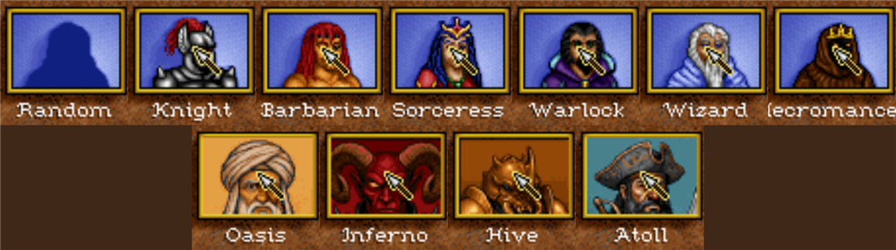

* **In Modus I:** Gehen Sie zu `"NEW GAME"` -> `"STANDARD GAME"`. Tippen Sie unter `"Choose Color:"` auf das Reitersymbol, um durch alle aktivierten Schlösser zu wechseln (insgesamt bis zu zehn: Knight („Ritter“), Barbarian, Sorceress, Warlock, Oasis, Inferno, Hive, Atoll, Wizard und Necromancer).

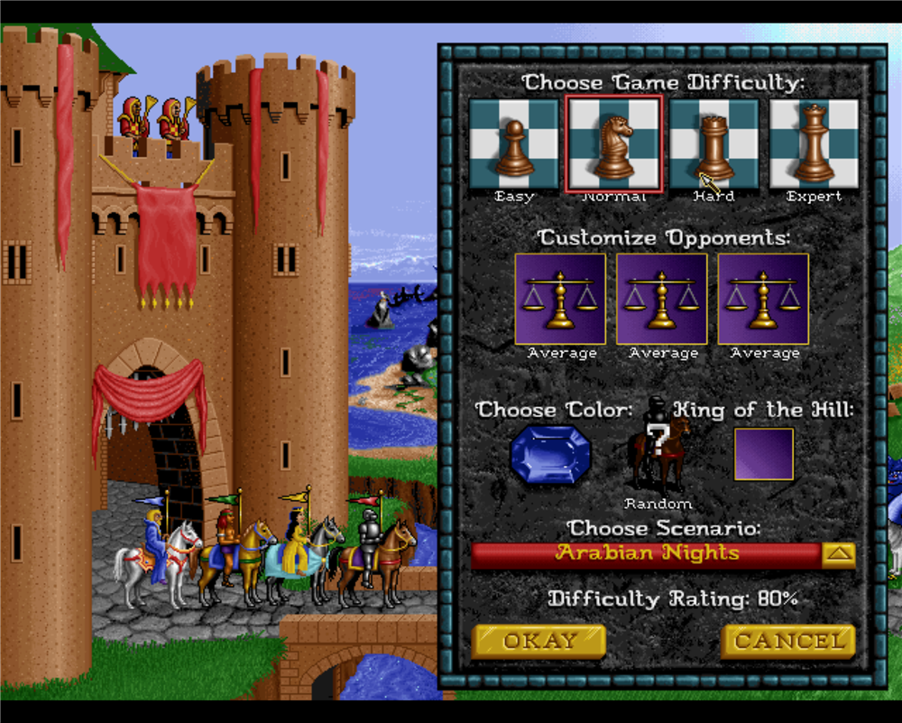

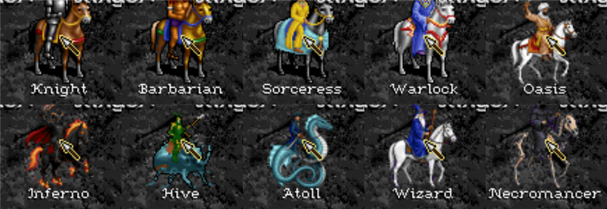

Jedes Schloss hat seinen eigenen individuellen Stadtbildschirm und ein eigenes Aussehen.

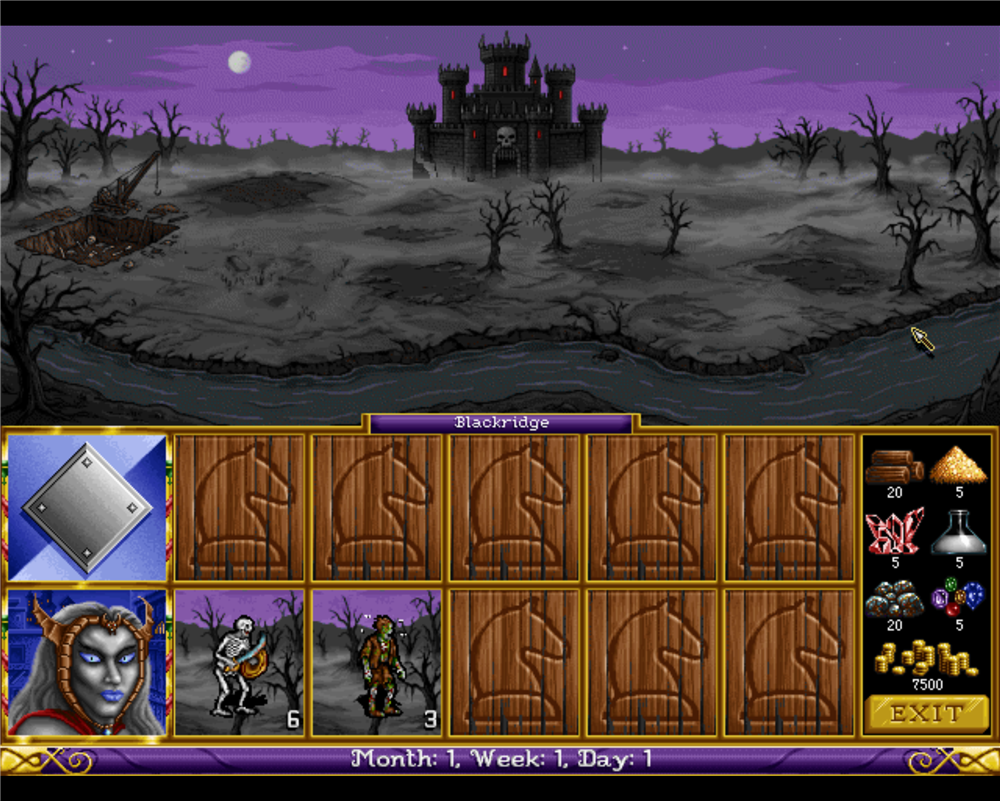

## Probleme melden

Nochmals vielen Dank, dass Sie diese Beta testen und uns helfen, H12 zu verbessern! Sie können Fehler und Vorschläge auf zwei Arten melden:

* **GitHub Issues:** https://github.com/h12-game/h12/issues
* **E-Mail:** h12.uniformed930@slmails.com

Wenn Sie ein Problem melden, geben Sie bitte die folgenden Details an:
* Spielversion (`1.0.0-beta.1`)
* Plattform (`PC` oder `Android`)
* Aktiver Spielmodus (`mode I` oder `mode II`)
* Ob `Price of Loyalty` installiert ist
* Klare Schritte zum Reproduzieren des Problems
* Das Spielprotokoll und, falls relevant, eine Spielstandsdatei

**Wo Sie das Protokoll finden:**
* **PC:** Die Protokolldatei wird unter `%APPDATA%\fheroes2\fheroes2.log` gespeichert (Spielstände befinden sich in `%APPDATA%\fheroes2\files\save`).
* **Android:** Das Spiel schreibt sein Protokoll unter dem Tag `fheroes2` in das Android-Systemprotokoll (`logcat`). Es schreibt keine Protokolldatei in den App-Ordner.

**Datenschutzhinweis:** GitHub Issues sind öffentlich. Wenn Sie eine E-Mail senden, werden Nachrichten über einen Alias-Dienst an ein Postfach weitergeleitet, in dem ein automatisierter Assistent (KI) sie sortiert. E-Mails werden höchstens 12 Monate lang aufbewahrt, und als Spam eingestufte Nachrichten werden nach 30 Tagen gelöscht.

## Bekannte kleinere Probleme in dieser Beta

* In Modus II zeigt die Beschriftung `"Extra Castles"` im Haupteinstellungsfenster möglicherweise `"Oasis + Inferno"` an, selbst wenn `Hive` und `Atoll` ebenfalls auf `On` gestellt sind. Öffnen Sie das Fenster `"Extra Castles"`, um den tatsächlichen Status jedes Schlosses zu sehen.
* Die Meldung `"Heroes 1 data required"` nennt nur `HEROES.AGG`, aber Modus I erfordert tatsächlich sowohl `HEROES.AGG` als auch `HEROES.EXE`.
