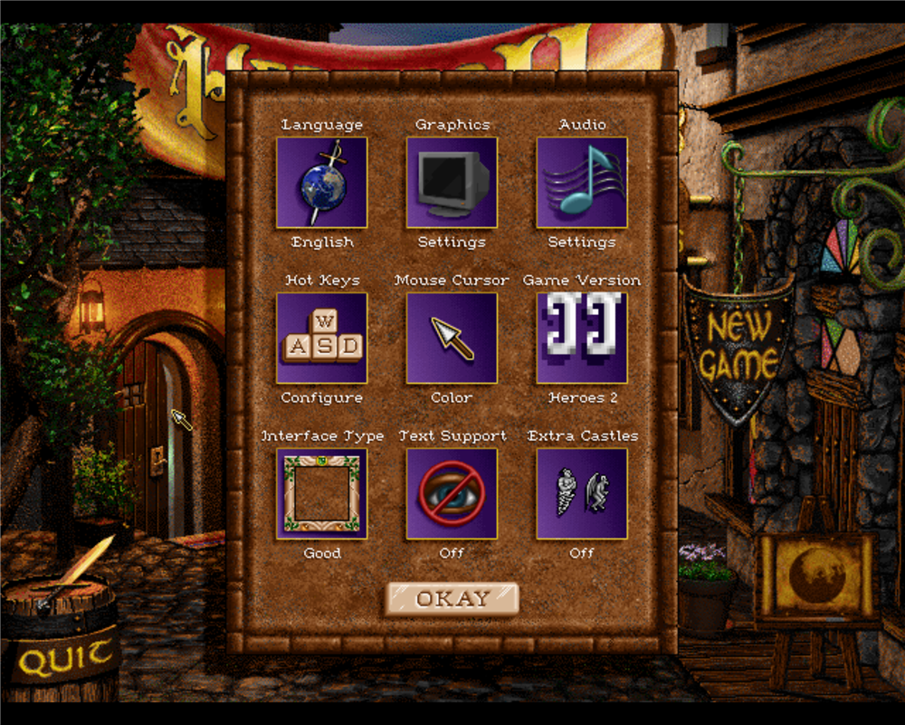
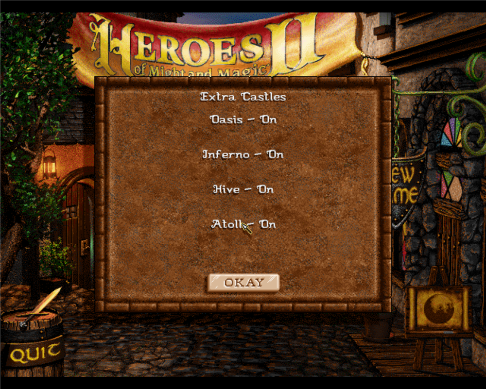

# H12-Installationsanleitung

Diese Anleitung ist eine maschinelle Übersetzung; Korrekturen sind über GitHub Issues willkommen.

H12 ist ein kostenloses Fanprojekt, das auf der fheroes2-Engine basiert und unter GPL-2.0-or-later lizenziert ist; es steht in keiner Verbindung zu Ubisoft oder New World Computing, und "Heroes of Might and Magic" ist eine Marke der jeweiligen Rechteinhaber. Version 1.0.0-beta.1 ist eine BETA, Sie gehören also zu den ersten menschlichen Testern: vielen Dank für Ihre Berichte!

## Was Sie benötigen

Sie benötigen Ihr eigenes Heroes of Might and Magic II; die GOG-Gold-Edition wird empfohlen, und Price of Loyalty ist optional. Für den Heroes-I-Modus benötigen Sie außerdem Ihr eigenes Heroes of Might and Magic, das ebenfalls auf GOG erhältlich ist. H12 enthält keine originalen Spieldateien.

## Windows

**Schritt 1.** Laden Sie `H12-1.0.0-beta.1-windows-x64.zip` von der Release-Seite herunter.

**Schritt 2.** Entpacken Sie die gesamte ZIP-Datei in einen beschreibbaren Ordner wie `C:\Games\H12`, sodass alles zusammenbleibt.

**Schritt 3.** Kopieren Sie die Heroes-II-Ordner `DATA`, `MAPS`, `MUSIC` und `ANIM` neben `H12.exe`. Windows führt `DATA` mit dem vorhandenen Ordner `data` zusammen: Behalten Sie dessen PNG-Unterordner bei. `DATA/HEROES2.AGG` ist erforderlich; `DATA/HEROES2X.AGG` fügt Price of Loyalty hinzu.

**Schritt 4.** Kopieren Sie für den Heroes-I-Modus `DATA\HEROES.AGG` und `HEROES.EXE` nach `DATA`. H12 liest `HEROES.EXE` nur als Daten; das Programm führt sie niemals aus.

**Schritt 5.** Kopieren Sie optional `homm1.gog` für Musik und Videos von Heroes I nach `DATA`, und kopieren Sie `MAPS\*.MAP` sowie `*.CMP` nach `MAPS`; H12 konvertiert diese Karten automatisch.

Ihr fertiger Ordner wird so aussehen:

```text
H12\
├── H12.exe, DLL files, files\
├── DATA\  (packaged PNG subfolders)
│   ├── HEROES2.AGG, HEROES2X.AGG
│   └── HEROES.AGG, HEROES.EXE, homm1.gog
├── MAPS\  (Heroes II and optional Heroes I maps)
├── MUSIC\
└── ANIM\
```

**Schritt 6.** Starten Sie `H12.exe`. Windows zeigt möglicherweise eine SmartScreen-Warnung an, da das Programm nicht signiert ist. Einstellungen, Spielstände und das Protokoll befinden sich in `%APPDATA%\fheroes2` und werden mit dem standardmäßigen fheroes2 geteilt.

## Android

**Schritt 1.** Laden Sie `H12-1.0.0-beta.1.apk` von der Release-Seite herunter und installieren Sie sie. Erlauben Sie bei Nachfrage unbekannte Quellen; H12 benötigt keine Internetberechtigung.

**Schritt 2.** Erstellen Sie auf einem Computer eine ZIP-Datei Ihres Heroes-II-Ordners, die `DATA/HEROES2.AGG` enthält. Price of Loyalty wird automatisch eingebunden, falls vorhanden.

**Schritt 3.** Erstellen Sie für den Heroes-I-Modus eine zweite ZIP-Datei Ihres Ordners von Heroes of Might and Magic, die `DATA/HEROES.AGG` und `HEROES.EXE` enthält. `MAPS` und `homm1.gog` sind optional. Jede ZIP-Datei ist etwa 400 MB groß.

**Schritt 4.** Kopieren Sie die ZIP-Datei oder beide ZIP-Dateien auf Ihr Smartphone, beispielsweise in den Ordner Downloads.

**Schritt 5.** Öffnen Sie H12.


**Schritt 6.** Tippen Sie auf "LOAD DATA FROM A ZIP" und wählen Sie die Heroes-II-ZIP-Datei aus. Warten Sie ein oder zwei Minuten bei eingeschaltetem Bildschirm; wiederholen Sie den Vorgang für die Heroes-I-ZIP-Datei.


**Schritt 7.** Tippen Sie auf "START GAME", sobald Heroes 2 geladen ist. Nutzen Sie "SAVED GAMES", um Spielstände zu verwalten.

## Erster Start, Spielmodi und Burgen

**Schritt 1.** Wählen Sie bei "Select Game Language:" eine Sprache aus; Englisch ist voreingestellt. Auf einem Touchscreen wirkt ein langes Berühren gefolgt von einer zweiten Berührung wie ein Rechtsklick.

**Schritt 2.** Öffnen Sie die Einstellungen über das Hauptmenü: Wählen Sie in Heroes II die Haustür auf der linken Seite oder in Heroes I den linken Turm der Burg. Drücken Sie auf einem PC stattdessen `T`.



**Schritt 3.** Verwenden Sie "Game Version", um zwischen Heroes 2 und Heroes 1 zu wechseln. Das Spiel merkt sich Ihre Auswahl. Ohne Heroes-I-Dateien zeigt es "Heroes 1 data required" an und bleibt in Heroes II.

**Schritt 4.** Öffnen Sie in den Einstellungen "Extra Castles" und aktivieren Sie die gewünschten Burgen. Sie sind standardmäßig auf Off gesetzt. Heroes II bietet Oasis, Inferno, Hive und Atoll; Heroes I bietet zusätzlich Wizard und Necromancer.



**Schritt 5.** Wählen Sie "NEW GAME" -> "STANDARD GAME". Tippen Sie in Heroes II auf das Bild unter "Class:"; festgelegte Klassen werden grau dargestellt, versuchen Sie es also mit "Pandemonium" oder "Broken Alliance". Tippen Sie in Heroes I auf den Reiter unter "Choose Color:", um aus bis zu zehn Burgen zu wählen.


## Probleme melden

Senden Sie Berichte an https://github.com/h12-game/h12/issues oder h12.uniformed930@slmails.com. Geben Sie Version 1.0.0-beta.1, PC oder Android, Modus I oder II, ob Price of Loyalty installiert ist, Schritte zur Reproduktion, das Protokoll und gegebenenfalls einen Spielstand an.

Auf dem PC befindet sich das Protokoll unter `%APPDATA%\fheroes2\fheroes2.log` und Spielstände liegen in `%APPDATA%\fheroes2\files\save`. Android schreibt in das Systemprotokoll (`logcat`) unter dem Tag `fheroes2`.

GitHub Issues sind öffentlich. E-Mails laufen über einen Alias-Dienst in ein Postfach, das von einem automatisierten Assistenten (KI) sortiert wird; sie werden maximal 12 Monate aufbewahrt, und Spam wird nach 30 Tagen gelöscht.

## Bekannte kleine Probleme

- In Heroes II zeigt "Extra Castles" möglicherweise "Oasis + Inferno" an, selbst wenn Hive und Atoll auf On stehen. Öffnen Sie das Fenster, um deren tatsächlichen Zustand zu sehen.
- "Heroes 1 data required" nennt nur `HEROES.AGG`, aber der Heroes-I-Modus benötigt sowohl `HEROES.AGG` als auch `HEROES.EXE`.
