# Guía de instalación de H12

Esta guía es una traducción automática; las correcciones son bienvenidas a través de GitHub Issues.

Bienvenido a H12 (versión 1.0.0-beta.1). H12 es un proyecto de fans basado en el motor fheroes2 y se publica bajo la licencia GPL-2.0-or-later. No está afiliado a Ubisoft ni a New World Computing. "Heroes of Might and Magic" es una marca comercial de sus respectivos propietarios.

Esta publicación es una versión BETA. La prueba alfa se llevó a cabo principalmente mediante inteligencia artificial a través de partidas automatizadas y pruebas automatizadas sin ventana de juego. Por ello, usted se encuentra entre los primeros probadores humanos en jugar a H12. ¡Gracias por cada informe de error y sugerencia que nos envíe! Si encuentra algún problema o quiere compartir sus comentarios, consulte la sección [Informar de problemas](#informar-de-problemas) al final de esta guía.

Esta guía explica cómo instalar H12 en Windows y Android, cómo cambiar entre el modo Heroes 1 y Heroes 2, y cómo activar los nuevos castillos. No es una guía sobre cómo jugar al juego en sí.

## Qué necesita

H12 no incluye archivos de los juegos originales, y el juego no puede iniciarse sin sus propios archivos.

* **Para ambos modos (Heroes II y Heroes I):** Necesita su propia copia de Heroes of Might and Magic II. Recomendamos la edición Gold de GOG. La expansión Price of Loyalty es opcional.
* **Para el modo Heroes 1 (opcional):** También necesita su propia copia del primer juego Heroes of Might and Magic, que también se vende en GOG.

## Windows (PC)

Siga estos pasos para instalar y ejecutar H12 en un PC con Windows:

1. Descargue `H12-1.0.0-beta.1-windows-x64.zip` desde la página de la versión.
2. Extraiga el archivo ZIP completo en una carpeta con permisos de escritura en su ordenador, por ejemplo `C:\Games\H12`. Asegúrese de mantener juntos en el mismo lugar `H12.exe`, los seis archivos DLL (`SDL2.dll`, `SDL2_mixer.dll`, `libz.dll`, `libc++.dll`, `libunwind.dll`, `libwinpthread-1.dll`), la carpeta `files` y la carpeta `data`.
3. **Añadir los archivos de Heroes II (obligatorio):** Abra su carpeta de instalación original de Heroes II. Copie el contenido de las carpetas `DATA`, `MAPS`, `MUSIC` y `ANIM` en carpetas con los mismos nombres justo al lado de `H12.exe` (cree estas carpetas si es necesario).
   * `DATA/HEROES2.AGG` es obligatorio para iniciar el juego.
   * `DATA/HEROES2X.AGG` es opcional y activa el contenido de Price of Loyalty.
   * Conserve las subcarpetas PNG incluidas dentro de `data/`. Windows trata `DATA` y `data` como la misma carpeta, por lo que los archivos copiados de `DATA` van directamente a esa carpeta existente junto a las subcarpetas PNG.
4. **Añadir los archivos de Heroes I (opcional, para el modo I):** Abra su carpeta original de Heroes of Might and Magic y copie los siguientes archivos en su carpeta de H12:
   * Copie `DATA\HEROES.AGG` en `DATA\HEROES.AGG` (obligatorio para el modo I).
   * Copie `HEROES.EXE` en `DATA\HEROES.EXE` (obligatorio para el modo I; este archivo solo se lee como datos y nunca se ejecuta).
   * Copie `homm1.gog` en `DATA\homm1.gog` (opcional; añade la música y el vídeo de Heroes I).
   * Copie los archivos de mapas originales `MAPS\*.MAP` y `MAPS\*.CMP` en la carpeta `MAPS\` junto a `H12.exe` (opcional; añade escenarios de Heroes I, que H12 convierte automáticamente).
5. Inicie el juego ejecutando `H12.exe`. Windows puede mostrar una advertencia de SmartScreen porque el programa no está firmado.

Así se ve su carpeta justo después de extraer el archivo ZIP de H12, y así se ve después de añadir los archivos de sus juegos originales:

```text
ANTES (extraído de H12-1.0.0-beta.1-windows-x64.zip):
C:\Games\H12\
├── H12.exe
├── SDL2.dll
├── SDL2_mixer.dll
├── libz.dll
├── libc++.dll
├── libunwind.dll
├── libwinpthread-1.dll
├── files\
└── data\
    └── (subcarpetas PNG incluidas)

DESPUÉS (con los archivos de Heroes II y Heroes I copiados):
C:\Games\H12\
├── H12.exe
├── SDL2.dll
├── SDL2_mixer.dll
├── libz.dll
├── libc++.dll
├── libunwind.dll
├── libwinpthread-1.dll
├── files\
├── DATA\ (la misma carpeta que data\)
│   ├── (subcarpetas PNG incluidas)
│   ├── HEROES2.AGG
│   ├── HEROES2X.AGG         (opcional, Price of Loyalty)
│   ├── HEROES.AGG           (obligatorio para el modo I)
│   ├── HEROES.EXE           (obligatorio para el modo I, leído solo como datos)
│   └── homm1.gog            (opcional, música y vídeo de Heroes I)
├── MAPS\
│   ├── (mapas de Heroes II)
│   └── (archivos *.MAP y *.CMP de Heroes I)
├── MUSIC\
│   └── (archivos de música de Heroes II)
└── ANIM\
    └── (archivos de animación de Heroes II)
```

Sus ajustes, partidas guardadas y archivo de registro se almacenan en `%APPDATA%\fheroes2`:
* Partidas guardadas: `%APPDATA%\fheroes2\files\save`
* Archivo de registro: `%APPDATA%\fheroes2\fheroes2.log`

Esta es exactamente la misma carpeta que utiliza el motor fheroes2 estándar. Si también utiliza fheroes2 en su PC, ambos programas comparten esta carpeta.

## Android

Siga estos pasos para instalar H12 y cargar los datos de su juego en Android:

1. Descargue `H12-1.0.0-beta.1.apk` desde la página de la versión e instálelo en su teléfono. Permita la instalación de aplicaciones de orígenes desconocidos cuando su teléfono lo solicite. La aplicación no necesita permiso de acceso a internet.
2. En un ordenador, cree un archivo ZIP a partir de su carpeta del juego Heroes II. Debe contener `DATA/HEROES2.AGG`. Si `DATA/HEROES2X.AGG` está dentro del ZIP, Price of Loyalty se incluye automáticamente.
3. Si quiere jugar al modo I, cree un segundo archivo ZIP a partir de su carpeta de Heroes of Might and Magic. Debe contener `DATA/HEROES.AGG` y `HEROES.EXE`. Incluir la carpeta `MAPS` (con los archivos `.MAP` y `.CMP`) y `homm1.gog` es opcional. Cada archivo ZIP ocupa unos 400 MB, así que asegúrese de que su teléfono tenga suficiente espacio libre.
4. Copie el archivo ZIP (o ambos archivos ZIP) a su teléfono, por ejemplo en la carpeta `Downloads`.
5. Abra H12 en su teléfono. La pantalla de inicio dice `"The game needs the data of your own copy."` y muestra una lista de estado `"Loaded:"` (`Heroes 2`, `Price of Loyalty`, `Heroes 1`, `Heroes 1 maps`, `homm1.gog`). El botón `"START GAME"` está desactivado hasta que se cargue `Heroes 2`. La pantalla de inicio también muestra los enlaces para enviar comentarios.

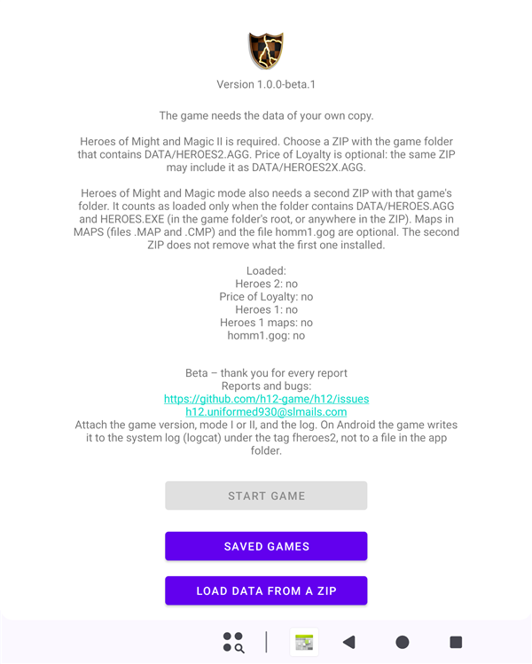

6. Toque `"LOAD DATA FROM A ZIP"` y elija su archivo ZIP de Heroes II en el selector de archivos.

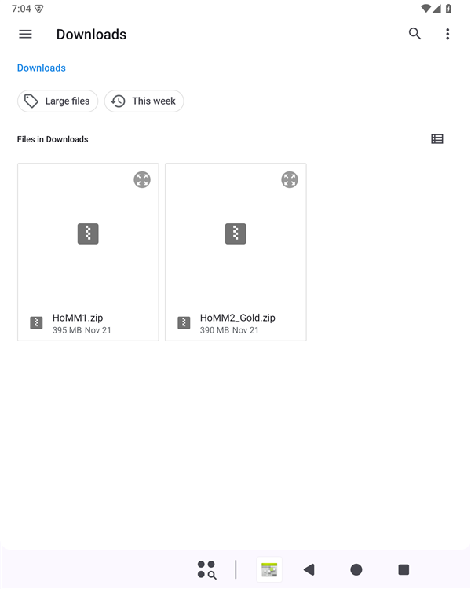

7. Espere mientras el juego descomprime el archivo. La descompresión tarda uno o dos minutos; por favor, mantenga la pantalla abierta. Cuando termina, la pantalla muestra `"Heroes 2: yes"` (y `"Price of Loyalty: yes"` si está incluido).


8. Para el modo I, toque `"LOAD DATA FROM A ZIP"` de nuevo y elija su archivo ZIP de Heroes I. Cargar el segundo ZIP no elimina lo que instaló el primero. Una vez completado, las cinco líneas dicen `"yes"`.

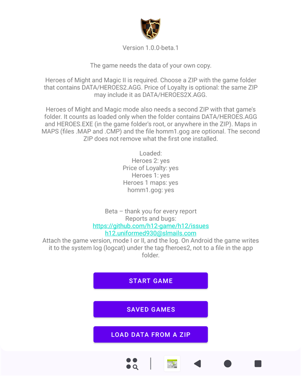

9. Toque `"START GAME"` para iniciar H12. También puede gestionar sus partidas guardadas desde esta pantalla tocando `"SAVED GAMES"`.

## Primer inicio

Cuando inicie el juego por primera vez, le pedirá que elija un idioma en `"Select Game Language:"` ("Seleccionar Idioma del Juego:"). El inglés está preseleccionado.

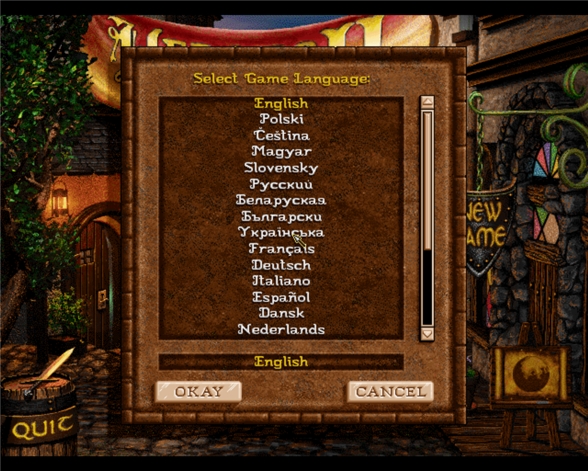

Después de confirmar el idioma, aparece un breve mensaje de bienvenida. Explica que, en las pantallas táctiles, un toque prolongado seguido de un segundo toque simula un clic derecho.

## Cambiar entre Heroes II y Heroes I

Puede cambiar entre Heroes II (modo II) y Heroes I (modo I) en los ajustes del juego, que se abren desde el menú principal. El juego recuerda el modo elegido para el próximo inicio.

1. En el menú principal de Heroes II, abra los ajustes del juego tocando (o haciendo clic en) la puerta de la casa a la izquierda. También puede tocar `"SETTINGS"` ("Ajustes") en el menú `"NEW GAME"` ("Nueva Partida") de Heroes II, o pulsar `T` en el menú principal en un PC.

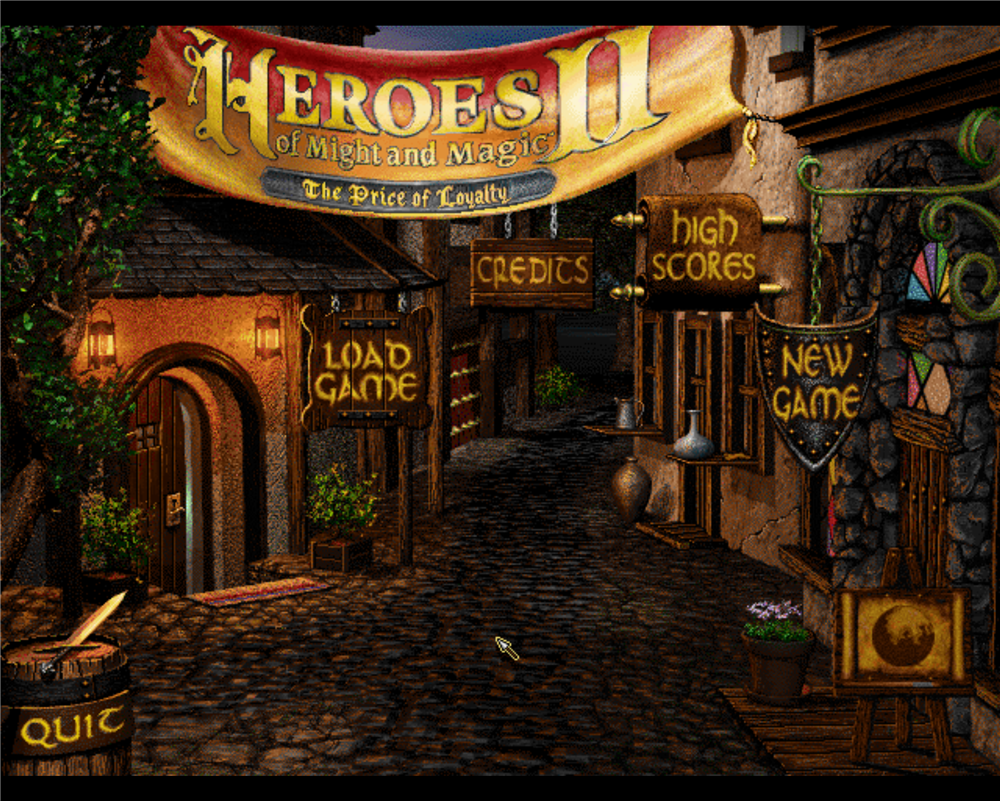

2. En la ventana de ajustes, busque `"Game Version"`. Muestra `"Heroes 2"` o `"Heroes 1"`. Tóquelo (o haga clic en él) para cambiar entre los dos modos.

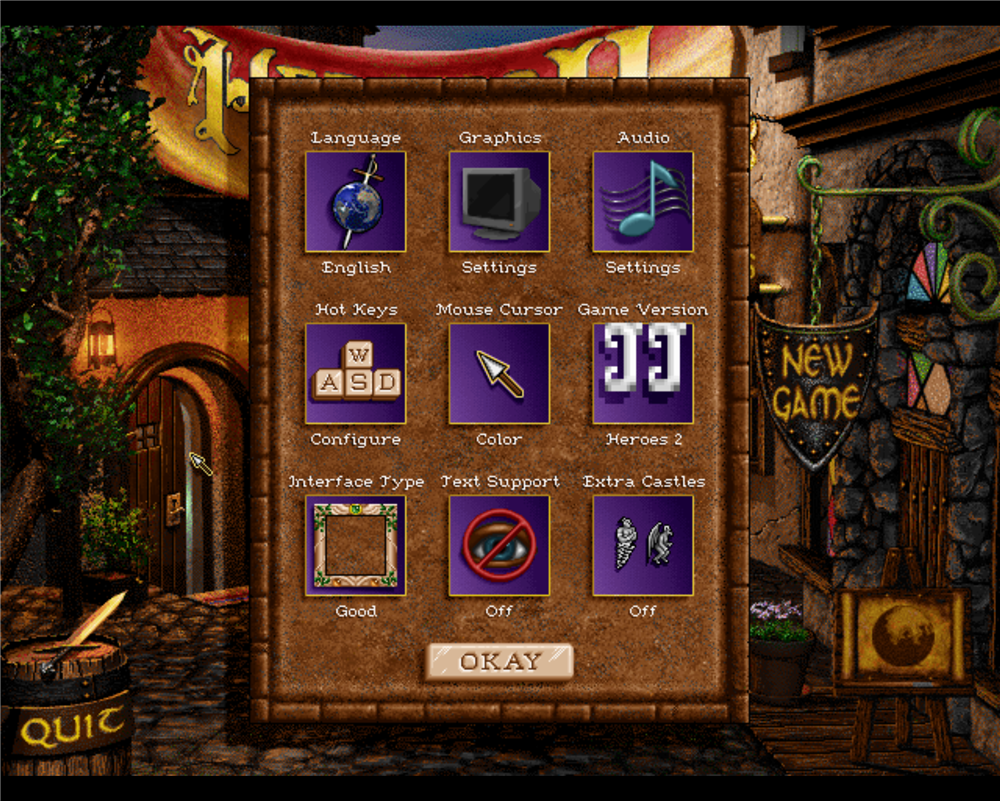

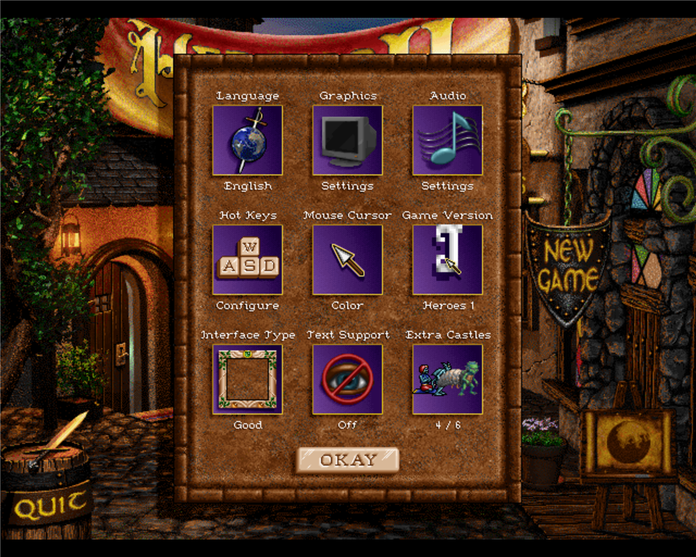

3. Si intenta cambiar a `"Heroes 1"` sin tener instalados los archivos necesarios de Heroes I, el juego muestra el mensaje `"Heroes 1 data required"` y permanece en el modo Heroes II.

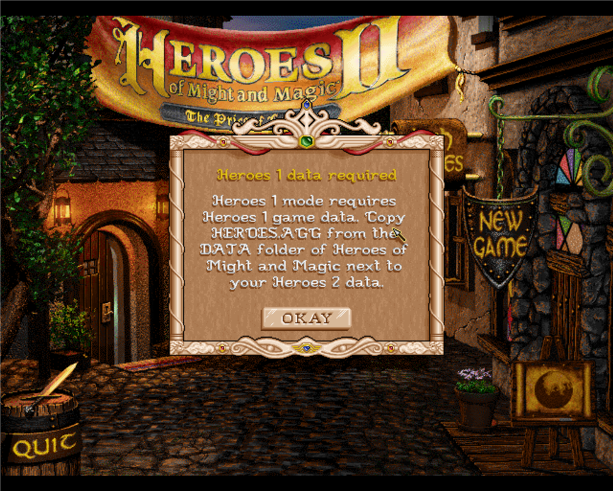

4. Cuando cambia al modo I, el menú principal cambia para verse como el Heroes of Might and Magic original.

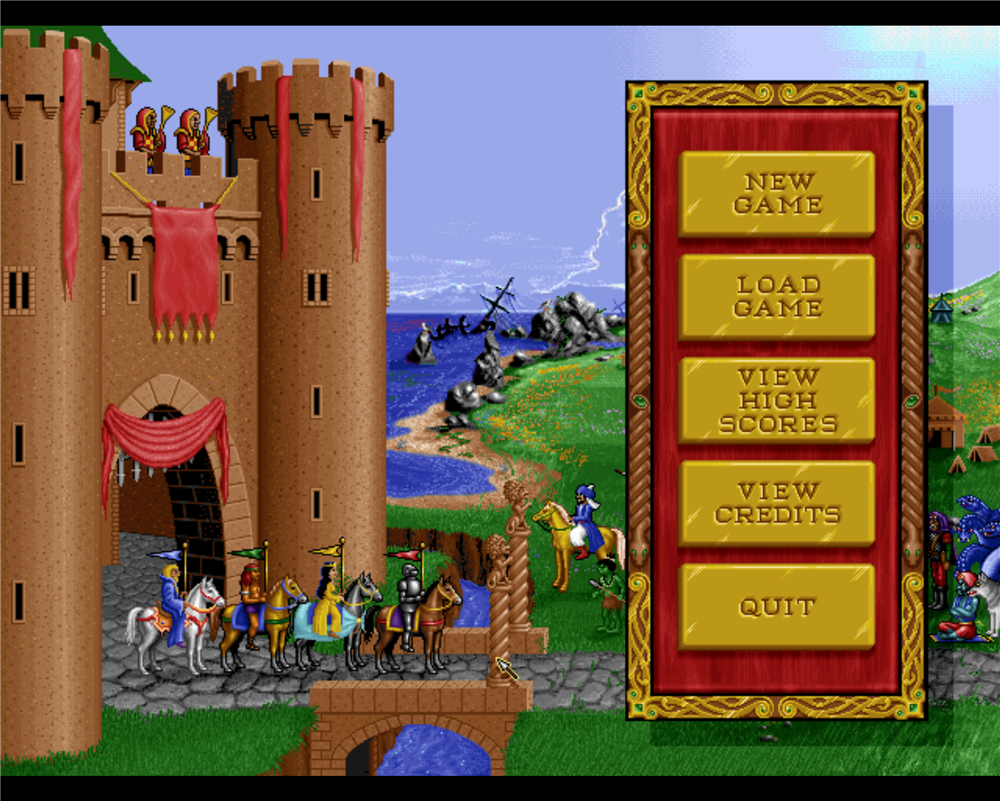

5. Para abrir los ajustes mientras está en el menú principal del modo I, toque (o haga clic en) la torre izquierda del castillo, o pulse `T` en un PC.

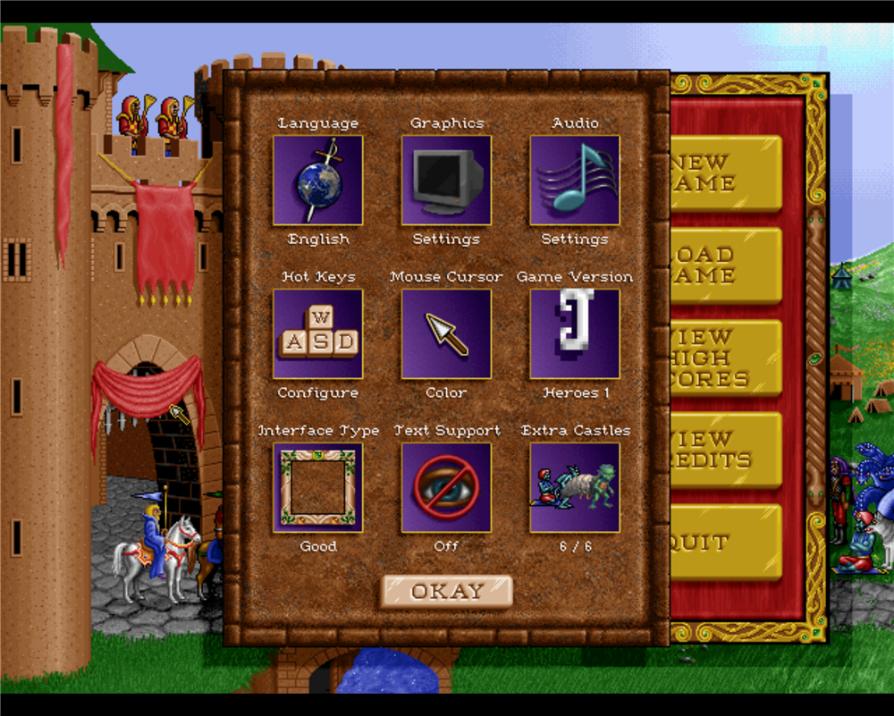

## Nuevos castillos

H12 incluye nuevos castillos que están desactivados (`Off`, "Desactivado") por defecto. Puede activarlos en los ajustes del juego:

1. Abra los ajustes y toque `"Extra Castles"`.
2. En el modo II, la ventana ofrece cuatro nuevos castillos: `Oasis`, `Inferno`, `Hive` y `Atoll`. Toque el nombre de un castillo para cambiarlo a `On` ("Activado") u `Off`.

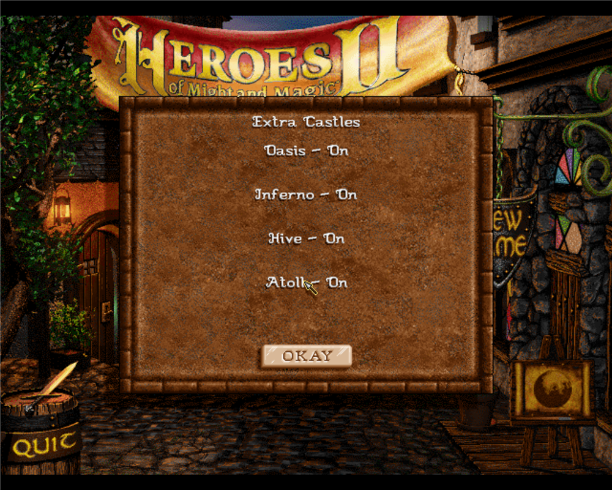

3. En el modo I, la ventana `"Extra Castles"` ofrece además `Wizard` ("Mago") y `Necromancer` ("Nigromante"), lo que le da 6 castillos adicionales en total. Toque cualquier nombre para cambiarlo a `On` u `Off`.

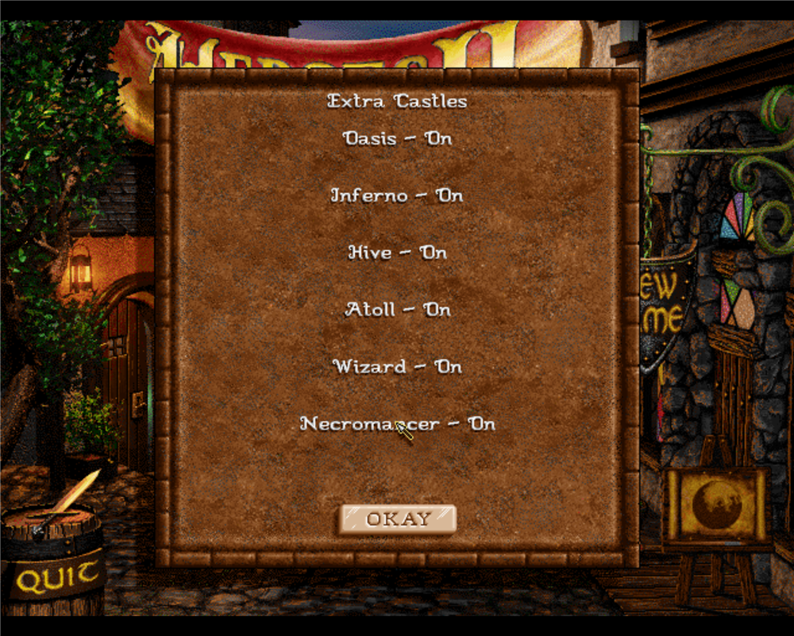

Una vez activados, puede elegir los nuevos castillos al iniciar una partida estándar:

* **En el modo II:** Vaya a `"NEW GAME"` -> `"STANDARD GAME"` ("Juego estandar") y elija un escenario con `"SELECT"`. En `"Class:"` ("Raza:"), toque la imagen de su clase para recorrer todas las clases disponibles, incluidos los nuevos castillos. Tenga en cuenta que algunos mapas tienen clases fijas (que se muestran como una imagen gris). Para probar los nuevos castillos, elija un mapa cuya clase se pueda cambiar, por ejemplo `"Pandemonium"` o `"Broken Alliance"`.

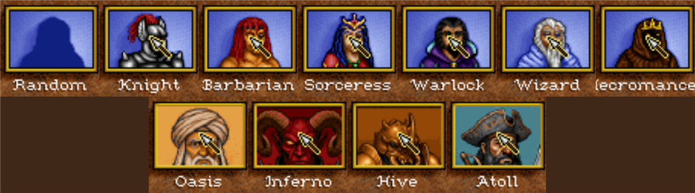

* **En el modo I:** Vaya a `"NEW GAME"` -> `"STANDARD GAME"`. En `"Choose Color:"`, toque el icono del jinete para recorrer todos los castillos activados (hasta diez en total: Knight ("Caballero"), Barbarian, Sorceress, Warlock, Oasis, Inferno, Hive, Atoll, Wizard y Necromancer).

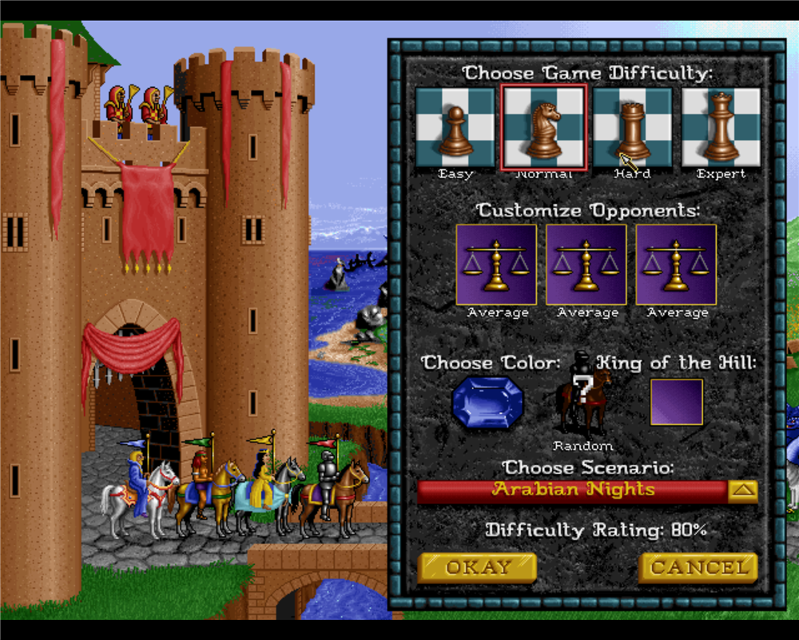

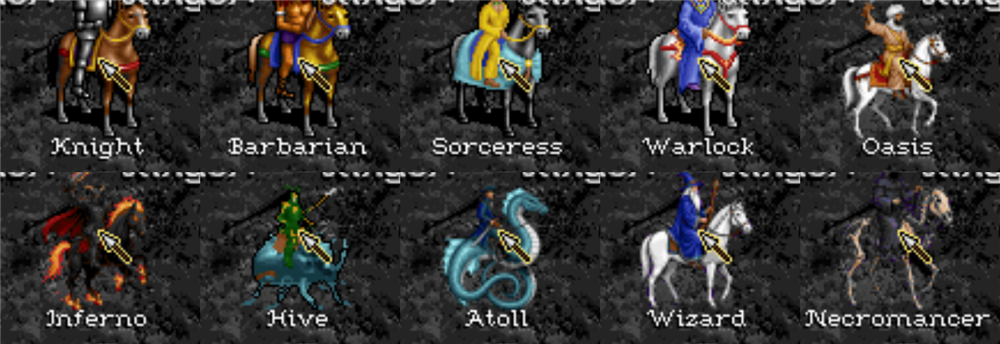

Cada castillo tiene su propia pantalla de ciudad y apariencia distintivas.

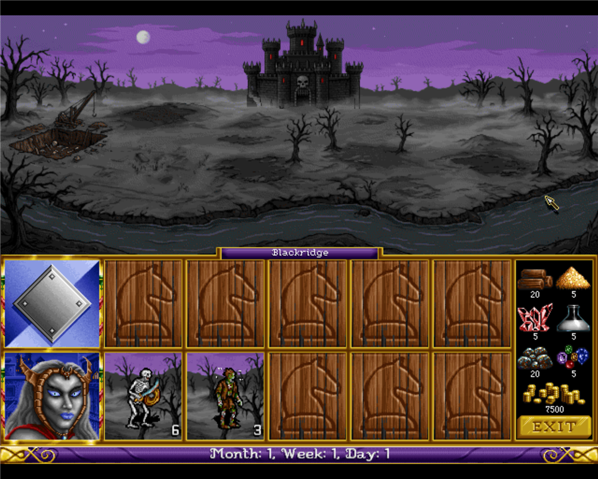

## Informar de problemas

¡Gracias de nuevo por probar esta beta y ayudarnos a mejorar H12! Puede informar de errores y enviar sugerencias de dos maneras:

* **GitHub Issues:** https://github.com/h12-game/h12/issues
* **Correo electrónico:** h12.uniformed930@slmails.com

Al informar de un problema, incluya los siguientes detalles:
* Versión del juego (`1.0.0-beta.1`)
* Plataforma (`PC` o `Android`)
* Modo de juego activo (`mode I` o `mode II`)
* Si `Price of Loyalty` está instalado
* Pasos claros para reproducir el problema
* El registro del juego y, si es relevante, un archivo de partida guardada

**Dónde encontrar el registro:**
* **PC:** El archivo de registro se guarda en `%APPDATA%\fheroes2\fheroes2.log` (las partidas guardadas están en `%APPDATA%\fheroes2\files\save`).
* **Android:** El juego escribe su registro en el registro del sistema Android (`logcat`) bajo la etiqueta `fheroes2`. No escribe un archivo de registro en la carpeta de la aplicación.

**Nota de privacidad:** Los GitHub Issues son públicos. Si envía un correo electrónico, los mensajes son reenviados por un servicio de alias a un buzón donde un asistente automatizado (IA) los clasifica. Los correos electrónicos se conservan como máximo 12 meses, y los mensajes retenidos como spam se eliminan después de 30 días.

## Pequeños problemas conocidos en esta beta

* En el modo II, la etiqueta `"Extra Castles"` en la ventana principal de ajustes puede decir `"Oasis + Inferno"` incluso cuando `Hive` y `Atoll` también están en `On`. Abra la ventana `"Extra Castles"` para ver el estado real de cada castillo.
* El mensaje `"Heroes 1 data required"` menciona solo `HEROES.AGG`, pero el modo I en realidad requiere tanto `HEROES.AGG` como `HEROES.EXE`.
